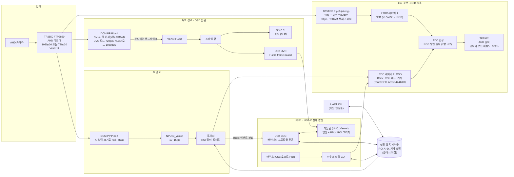

# 제품 구상 (Product Conception)

> 상태: **구상 (2026-11-14)**. 방향이 확정되면 `docs/prd.md`로 옮긴다. 아직 코드·PRD에는 반영하지 않았다.
> 확인이 필요한 하드웨어 사항은 7장에 모았다.

## 1. 한 줄 요약

AHD 카메라 1채널을 받아 **녹화(SD, OSD 없음) + AI 추론 + AHD 출력(OSD 포함)** 을 항상 하고, 태블릿 앱이 영상을 열면 **UVC로 녹화 스트림을 함께 보내는** 단일 펌웨어. 제품을 UVC/LCD로 나누지 않는다.

## 2. 블록도

- **파이프 셋이 역할을 하나씩 맡는다.** Pipe0 = 화면, Pipe1 = 인코딩, Pipe2 = AI. 모드가 바뀌어도 역할은 그대로이고 Pipe1의 해상도·프레임 수만 바뀐다(4.2).
- **녹화 경로** 에는 OSD가 없다. SD 녹화와 UVC는 같은 인코딩 스트림을 쓴다(인코딩 1회).
- **표시 경로** 에만 OSD(BBox, ROI, 메뉴, 커서)가 합성되어 AHD로 나간다.
- 태블릿 화면의 BBox·ROI는 영상에 그려져 오지 않고, CDC로 받은 좌표를 태블릿이 그린다.
- 인코딩 입력은 언제나 Pipe1 줄 버퍼 + 하드웨어 핸드셰이크다(1단계 M4-6과 같은 방식). PSRAM을 거치지 않아 UVC 지연이 낮고 대역폭도 아낀다.

## 3. 해상도와 모드

| 입력 | 모드 | 녹화(SD) | UVC | AHD 출력 |
| --- | --- | --- | --- | --- |
| 1080p30 | 태블릿 영상 열림 (UVC 모드) | **720p30** | **720p30** (녹화와 같은 스트림) | 1080p30 |
| 1080p30 | 그 밖 (LCD 모드) | **1080p15** | - | 1080p30 |
| 720p30 | 모드 상관없음 | 720p30 | 720p30 | 720p30 |

- AHD 출력은 언제나 입력 해상도 그대로, 30fps (1080은 1080, 720은 720).
- 1080p 입력에서 UVC 모드에는 녹화도 720p30이 된다. 태블릿이 30fps로 보도록 하면서 인코딩은 한 번만 하기 위해서다(1080p30 인코딩은 PSRAM 대역폭이 한계에 걸림, 6장).
- 720p 입력은 모드가 바뀌어도 아무것도 바뀌지 않는다.
- 입력 해상도가 바뀌면(카메라 교체) 파이프라인 전체를 다시 설정한다.

## 4. 동작

### 4.1 USB1 상대에 따라 (USB-C CC 판별)

| 꽂힌 것 | 보드 역할 | 동작 |
| --- | --- | --- |
| 태블릿 (UVC_Viewer) | USB 장치: CDC(IF0-1) + UVC(IF2-3) | 태블릿에서 설정(CDC 프로토콜). 앱이 영상을 열면 UVC 모드 |
| 마우스 (USB-C OTG 젠더) | USB 호스트: HID, VBUS 5 V 공급 | 설정 모드: OSD에 메뉴바, ROI 꼭짓점 원형 핸들, 커서 |
| 없음 | - | 녹화 + AI + AHD 출력 |

- 녹화·AI·AHD 출력은 USB 상태와 상관없이 **항상** 돈다.
- 태블릿 연결 중에는 마우스를 쓸 수 없다(같은 포트). 설정은 태블릿이 맡는다.
- 마우스를 빼면 설정 모드를 끝내고 메뉴·핸들·커서를 숨긴다.

### 4.2 UVC 모드 전환 (1080p 입력일 때만)

- **기준은 UVC 스트림 시작/종료다.** 태블릿을 꽂기만 하고 앱이 영상을 열지 않으면 LCD 모드(1080p15 녹화)를 유지한다. 앱이 영상을 열면(UVC Commit) UVC 모드, 닫거나 분리하면 LCD 모드로 돌아간다.
- 전환 때 하는 일: Pipe1 해상도·프레임 수 변경(720p30 ↔ 1080p15, DCMIPP 프레임 건너뛰기) + 인코더 재생성(1단계 M5의 `video_encoder_restart()`와 같은 동작). Pipe0(화면)·Pipe2(AI)는 건드리지 않으므로 AHD 출력과 AI는 끊기지 않는다.
- **녹화는 계속한다.** 전환 시점에서 파일을 나누고 새 파일은 IDR부터 시작한다. 인코더를 다시 만드는 동안 녹화가 수백 ms 비는 것과 파일마다 해상도가 다른 것은 받아들인다(2026-11-14 결정).
- UVC 스트림을 열 때 첫 프레임은 SPS/PPS + IDR이어야 하므로, 전환 직후 인코더의 첫 프레임이 그대로 UVC 첫 프레임이 된다.

### 4.3 설정의 원본은 보드

- 설정 항목 테이블 하나를 CDC 프로토콜(태블릿), 마우스 GUI(OSD), UART CLI가 함께 쓴다. 어디서 바꿔도 같은 값이다.
- 태블릿 프로토콜은 `2701_UVC_VIEWER/UVC_Viewer/docs/protocol.md`를 따른다(스키마·VALUES·SET·CHANGED·AREAS). 마우스나 CLI로 바꾸면 연결된 태블릿에 `CHANGED`를 보낸다.
- 보드가 원본이므로 설정과 ROI는 **플래시에 저장**한다(전원을 꺼도 유지).

### 4.4 좌표

| 쓰는 곳 | 기준 |
| --- | --- |
| 저장·프로토콜 | 영상 정수 픽셀, 왼쪽 아래 원점 (UVC_Viewer 규약). 기준 해상도는 입력 해상도 |
| UVC 영상 (1080p 입력의 UVC 모드) | 720p라 태블릿 좌표와 입력 좌표의 비율이 다르다. 프로토콜 좌표를 어느 해상도로 할지 정해야 한다 (7장 S-5) |
| OSD (LTDC) | 출력 픽셀, 왼쪽 위 원점 |
| AI 입력 | 축소·여백(letterbox) 좌표 |

변환은 한 모듈에서만 한다. 입력 해상도가 바뀌면 저장된 ROI는 비율로 다시 맞춘다.

## 5. 검토 결과 (2026-11-14, HAL·레지스터 정의 기준)

CubeN6 V1.4.1 HAL과 장치 헤더(`stm32n657xx.h`)로 확인한 것이다. 레퍼런스 매뉴얼(RM0486)로 최종 확인한다.

### 5.1 Pipe2로 VENC 핸드셰이크가 되는가

- Pipe2도 줄 버퍼 주소 되감기(line wrapping, `P2PPCR.LMAWE/LMAWM`)를 지원한다.
- 하지만 **Pipe2는 NV12(semi-planar)를 낼 수 없다.** HAL에 "Only DCMIPP_PIPE1 allows semi-planar buffer"로 되어 있고, Pipe2 출력 형식은 YUV422 1-버퍼까지다.
- VENC는 YUYV/UYVY 입력도 받고, 줄 버퍼 모드에서 입력 형식 제한은 API에 없다. 그래도 VENC 하드웨어 핸드셰이크 신호가 어느 파이프와 연결되는지는 매뉴얼로 확인해야 한다.
- **결론: 인코딩은 지금처럼 Pipe1(NV12 + 핸드셰이크, 이미 보드에서 검증)로 둔다.** 그 대신 화면을 Pipe0으로 옮긴다(2장).

### 5.2 GPU2D로 NV12를 축소할 수 있는가 (AI 입력)

- HAL의 GPU2D는 레지스터 접근만 있고, 입력 형식(YUV 텍스처 등)은 NemaGFX 라이브러리에 달려 있어 아직 확인하지 못했다.
- DMA2D는 YCbCr 입력이 JPEG 블록(MCU) 순서라 NV12 선형 버퍼에 맞지 않고, 크기 조절 기능이 없다.
- **결론: GPU2D 축소에 기대지 않고 AI에 Pipe2를 따로 준다.** Pipe2가 축소·RGB 변환을 직접 하므로 추가 복사가 없다.

### 5.3 그 결과 정한 파이프 배치

| 파이프 | 출력 | 쓰는 곳 | 근거 |
| --- | --- | --- | --- |
| Pipe0 (dump) | 입력 그대로 YUV422, 30fps, PSRAM 전체 프레임 | LTDC 레이어 1 | 입력이 이미 YUV라 ISP가 필요 없다. LTDC 레이어는 YUV422 coplanar(`LTDC_LayerFlexYUVCoPlanarTypeDef`)·NV12 입력을 받는다. LTDC에는 크기 조절이 없으므로 출력 해상도 = 입력 해상도로 맞는다 |
| Pipe1 | NV12, 줄 버퍼 + 핸드셰이크 | VENC | 1단계에서 검증한 경로. 720p30 ↔ 1080p15 전환 |
| Pipe2 | 축소 RGB | NPU | AI 입력 크기로 바로 출력 |

- **확인 필요(H-7):** Pipe0이 Pipe1·Pipe2와 같은 입력 스트림을 동시에 받을 수 있는지(CSI 가상 채널·데이터 형식 선택, 병렬 입력일 때도).
- 안 될 때 대안: Pipe2를 1080p YUV422 화면용으로 쓰고, AI 입력은 화면 프레임을 GPU2D로 축소(5.2 확인 필요) 또는 CPU로 축소한다.

### 5.4 새로 알게 된 것: LTDC 출력은 RGB

- N6 LTDC 레지스터(`LTDC_GCR`)에는 YCbCr 출력 설정이 보이지 않는다. 레이어 입력은 YUV를 받아 RGB로 바꾸지만, **출력은 RGB 병렬 + HSYNC/VSYNC/DE** 다.
- 처음 블록도의 "LTDC 합성 YUV422 16비트 출력"은 그대로는 안 될 가능성이 높다. TP2912가 RGB 입력이나 별도 동기 신호 입력을 받는지 데이터시트로 확인해야 한다(H-2). 안 받으면 RGB → BT.1120 변환이 따로 필요하다.

## 6. 자원 예산 (가늠, 실측 필요)

1080p30 입력 기준 PSRAM 사용 (YUV422 1프레임 약 4.1 MB):

| 사용처 | UVC 모드 | LCD 모드 |
| --- | --- | --- |
| Pipe0 쓰기 30fps | 124 | 124 |
| LTDC 영상 레이어 읽기 30 Hz | 124 | 124 |
| OSD 레이어 (ARGB4444) 읽기 + 그리기 | 70~100 | 70~100 |
| VENC 참조 프레임 (입력은 줄 버퍼라 PSRAM 아님) | 720p30: 80~100 | 1080p15: 90~110 |
| Pipe2 AI 입력, SD, 기타 | 수십 | 수십 |
| **합계 (MB/s)** | **약 420~470** | **약 430~480** |

- PSRAM(16비트 DDR 200 MHz) 이론값 800 MB/s, 여러 장치가 함께 쓸 때 실효 약 500 MB/s 안팎으로 본다. 들어오지만 여유는 크지 않다.
- 줄이는 방법: OSD를 L8(팔레트)로(약 −30~50), 메뉴가 없을 때 OSD 영역 축소. Pipe0을 NV12로 낼 수 있으면 화면 쪽이 248 → 186으로 준다(Pipe0은 형식 변환이 없어 입력 형식 그대로일 가능성이 높음, 확인 필요).
- 참고: 1080p30 녹화(인코딩 1회로 UVC도 1080p30)는 VENC 계산은 되지만(1단계 실측: 720p 약 9 ms/프레임 at HCLK 200 MHz → 1080p 약 20 ms 추정) PSRAM 합계가 약 550~600 MB/s로 한계를 넘을 수 있어 택하지 않았다.
- **내부 SRAM**: Pipe1 줄 버퍼가 1080p 폭이면 1920 × 64줄 × 1.5 = 약 184 KB (지금 720p 120 KB). NPU 작업 메모리, 앱 코드와 함께 배치를 정해야 한다.
- **장치 내부 지연(UVC)**: 인코딩 입력이 줄 버퍼 핸드셰이크라 1단계와 비슷한 수준(약 30 ms)을 기대한다.

## 7. 확인할 것

| 번호 | 항목 | 왜 |
| --- | --- | --- |
| H-1 | TP2850/TP2860 출력이 MIPI CSI-2인지 BT.656/BT.1120 병렬인지 | DCMIPP 입력 설정·핀이 완전히 다르다 |
| H-2 | TP2912 입력 형식. N6 LTDC 출력은 RGB 병렬 + HS/VS/DE (5.4) | RGB를 받지 못하면 변환 회로가 필요 |
| H-3 | LTDC 픽셀 클럭 74.25 MHz(1080p30/720p60 타이밍) 가능 여부 | AHD 출력 타이밍 |
| H-4 | DK에서 디코더 보드 연결 방법(MIPI CSI 커넥터 어댑터 등) | 개발 보드 시험 |
| H-5 | 태블릿과 마우스를 USB1 하나로 할지, USB2를 따로 쓸지 | 태블릿 연결 중 마우스 사용 여부 |
| H-6 | DK에서 USB1이 VBUS 5 V를 낼 수 있는지 실제 확인 | 마우스 전원 (BSP에는 Source 기능이 있음) |
| H-7 | Pipe0이 Pipe1·Pipe2와 같은 입력을 동시에 받는지, Pipe0 출력 형식 | 5.3 파이프 배치의 전제 |
| H-8 | VENC 하드웨어 핸드셰이크가 Pipe1 전용인지 | 5.1 (지금 배치는 Pipe1만 쓰므로 영향 없음, 참고) |
| S-1 | PSRAM 대역폭 실측 (6장) | 동시 동작의 가장 큰 위험 |
| S-2 | st_yoloxn 입력 크기와 Pipe2 축소·letterbox | AI 정확도·속도 |
| S-3 | 1080p 폭 줄 버퍼(약 184 KB)와 NPU 메모리의 내부 SRAM 배치 | 6장 |
| S-4 | 설정·ROI 플래시 저장 시점과 위치(외부 NOR) | 보드가 설정 원본 |
| S-5 | 1080p 입력의 UVC 모드(720p)에서 프로토콜 좌표 기준 | 태블릿 ROI·탭 좌표 변환 |
| S-6 | NemaGFX(GPU2D)의 YUV 입력·축소 지원 | 5.3 대안을 쓸 경우 |

## 8. 지금 펌웨어(1단계)에서 바뀌는 것

| 지금 | 구상 |
| --- | --- |
| IMX335 + ISP(AE/AWB) | AHD 디코더 YUV 입력, ISP 불필요. `cam ae/exp/gain/awb` 설정은 없어지거나 디코더 설정으로 바뀜 |
| 720p30 고정 | 입력(1080p30/720p30)과 모드를 따라감 |
| Pipe1 하나 | Pipe0 화면, Pipe1 인코딩, Pipe2 AI |
| CDC 텍스트 CLI | CDC는 바이너리 프로토콜 전용, CLI는 UART |
| 설정 저장 없음 | 플래시 저장 |
| UVC가 유일한 출력 | 출력은 SD 녹화·AHD·UVC, UVC는 태블릿 앱이 영상을 열 때만 |

유지되는 것: Pipe1 NV12 줄 버퍼 + VENC 하드웨어 핸드셰이크, 인코더 출력 → 프레임 큐 → 소비자(SD, UVC) 구조, 인코더 재생성 함수, 설정 항목 테이블, USB composite(CDC+UVC, IAD), 해상도·fps 설정값화.
