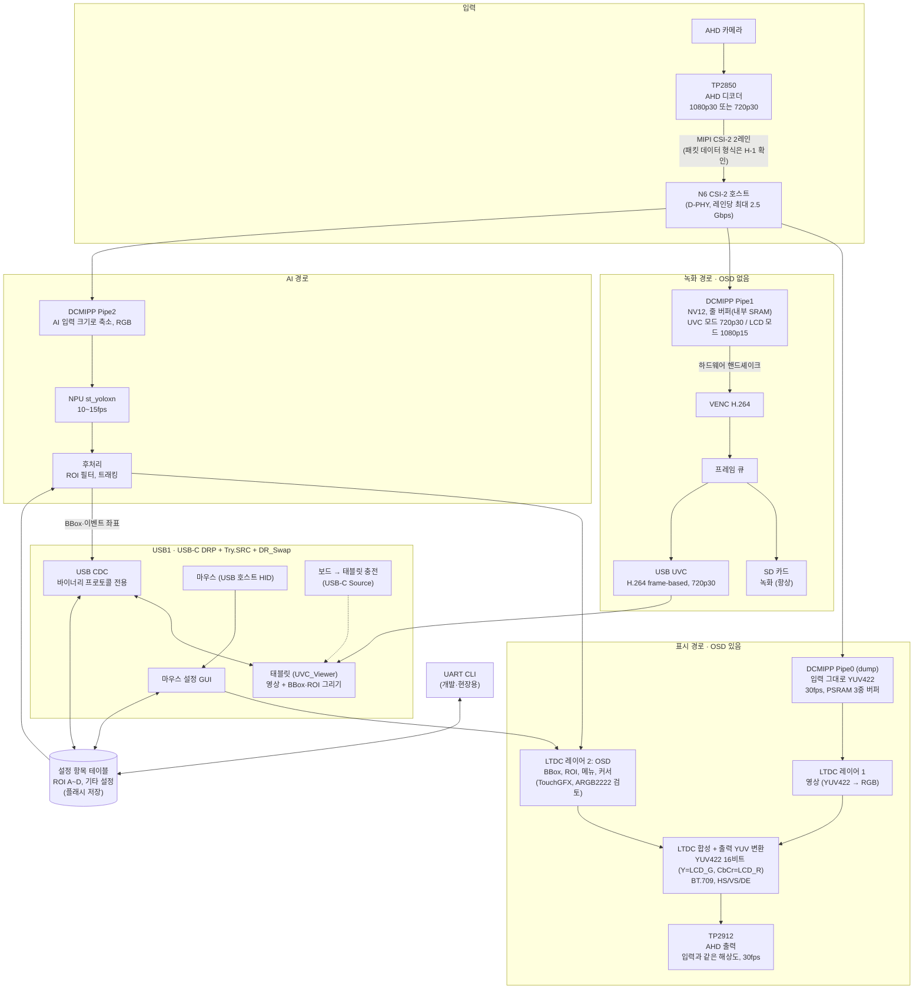

# 제품 구상 (Product Conception)

> 상태: **구상 (2026-11-14)**. 방향이 확정되면 `docs/prd.md`로 옮긴다. 아직 코드·PRD에는 반영하지 않았다.
> 이 문서의 블록도·파이프 배치는 **커스텀 보드**(TP2850 입력, TP2912 AHD 출력) 기준이다. 지금 개발하는 **DK 보드**(IMX335 입력, DK LCD 출력)와의 차이는 9장에 있다.
> 확인이 필요한 하드웨어 사항은 7장에 모았다.

## 1. 한 줄 요약

AHD 카메라 1채널을 받아 **녹화(SD, OSD 없음) + AI 추론 + AHD 출력(OSD 포함)** 을 항상 하고, 태블릿 앱이 영상을 열면 **UVC로 녹화 스트림을 함께 보내는** 단일 펌웨어. 제품을 UVC/LCD로 나누지 않는다.

## 2. 블록도

- **파이프 셋이 역할을 하나씩 맡는다.** Pipe0 = 화면, Pipe1 = 인코딩, Pipe2 = AI. 모드가 바뀌어도 역할은 그대로이고 Pipe1의 해상도·프레임 수만 바뀐다(4.2).
- **녹화 경로** 에는 OSD가 없다. SD 녹화와 UVC는 같은 인코딩 스트림을 쓴다(인코딩 1회).
- **표시 경로** 에만 OSD(BBox, ROI, 메뉴, 커서)가 합성되어 AHD로 나간다.
- 태블릿 화면의 BBox·ROI는 영상에 그려져 오지 않고, CDC로 받은 좌표를 태블릿이 그린다.
- 인코딩 입력은 언제나 Pipe1 줄 버퍼 + 하드웨어 핸드셰이크다(1단계 M4-6과 같은 방식). PSRAM을 거치지 않아 UVC 지연이 낮고 대역폭도 아낀다.

## 3. 해상도와 모드

| 입력 | 모드 | 녹화(SD) | UVC | AHD 출력 |
| --- | --- | --- | --- | --- |
| 1080p30 | 태블릿 영상 열림 (UVC 모드) | **720p30** | **720p30** (녹화와 같은 스트림) | 1080p30 |
| 1080p30 | 그 밖 (LCD 모드) | **1080p15** | - | 1080p30 |
| 720p30 | 모드 상관없음 | 720p30 | 720p30 | 720p30 |

- AHD 출력은 언제나 입력 해상도 그대로, 30fps (1080은 1080, 720은 720).
- 1080p 입력에서 UVC 모드에는 녹화도 720p30이 된다. 태블릿이 30fps로 보도록 하면서 인코딩은 한 번만 하기 위해서다(1080p30 인코딩은 PSRAM 대역폭이 한계에 걸림, 6장).
- 720p 입력은 모드가 바뀌어도 아무것도 바뀌지 않는다.
- 입력 해상도가 바뀌면(카메라 교체) 파이프라인 전체를 다시 설정한다.

## 4. 동작

### 4.1 USB1 상대에 따라 (USB-C CC 판별)

| 꽂힌 것 | 보드 역할 | 동작 |
| --- | --- | --- |
| 태블릿 (UVC_Viewer) | 전원: Source(태블릿 충전), 데이터: USB 장치 CDC(IF0-1) + UVC(IF2-3) | 태블릿에서 설정(CDC 프로토콜). 앱이 영상을 열면 UVC 모드 |
| 마우스 (USB-C OTG 젠더) | USB 호스트: HID, VBUS 5 V 공급 | 설정 모드: OSD에 메뉴바, ROI 꼭짓점 원형 핸들, 커서 |
| 없음 | - | 녹화 + AI + AHD 출력 |

- 녹화·AI·AHD 출력은 USB 상태와 상관없이 **항상** 돈다.
- **역할 결정 (커스텀 보드)**: USB-C는 전원 역할(누가 전원을 주나)과 데이터 역할(누가 호스트인가)이 따로다. 보드는 **DRP + Try.SRC**(가능하면 전원 주는 쪽을 택함)로 둔다(5.6 R-3).
  - 태블릿: 보드가 Source로 붙으면 규칙상 처음에는 보드가 호스트다. 보드가 PD **데이터 역할 교환(DR_Swap)** 을 요청해 장치가 되고, 태블릿이 호스트가 된다. 결과: **보드가 태블릿을 충전하면서 UVC·CDC 장치로 동작**한다.
  - 마우스(OTG 젠더의 Rd): 보드가 Source + 호스트로 바로 붙는다.
  - 태블릿이 DR_Swap을 받지 않으면: 충전 없이 보드가 Sink·장치로 붙는 대체 동작을 둔다.
- **DK 보드**: USB1(TCPP0203)의 Source 경로로 5 V를 낼 수 있는지와 역할 결정만 시험한다. 충전 전류 수준은 커스텀 보드에서 확인한다.
- 태블릿 연결 중에는 마우스를 쓸 수 없다(같은 포트). 설정은 태블릿이 맡는다.
- 마우스를 빼면 설정 모드를 끝내고 메뉴·핸들·커서를 숨긴다.

### 4.2 UVC 모드 전환 (1080p 입력일 때만)

- **기준은 UVC 스트림 시작/종료다.** 태블릿을 꽂기만 하고 앱이 영상을 열지 않으면 LCD 모드(1080p15 녹화)를 유지한다. 앱이 영상을 열면(UVC Commit) UVC 모드, 닫거나 분리하면 LCD 모드로 돌아간다.
- 전환 때 하는 일: Pipe1 해상도·프레임 수 변경(720p30 ↔ 1080p15, DCMIPP 프레임 건너뛰기) + 인코더 재생성(1단계 M5의 `video_encoder_restart()`와 같은 동작). Pipe0(화면)·Pipe2(AI)는 건드리지 않으므로 AHD 출력과 AI는 끊기지 않는다.
- **녹화는 계속한다.** 전환 시점에서 파일을 나누고 새 파일은 IDR부터 시작한다. 인코더를 다시 만드는 동안 녹화가 수백 ms 비는 것과 파일마다 해상도가 다른 것은 받아들인다(2026-11-14 결정).
- UVC 스트림을 열 때 첫 프레임은 SPS/PPS + IDR이어야 하므로, 전환 직후 인코더의 첫 프레임이 그대로 UVC 첫 프레임이 된다.

### 4.3 설정의 원본은 보드

- 설정 항목 테이블 하나를 CDC 프로토콜(태블릿), 마우스 GUI(OSD), UART CLI가 함께 쓴다. 어디서 바꿔도 같은 값이다.
- 태블릿 프로토콜은 `2701_UVC_VIEWER/UVC_Viewer/docs/protocol.md`를 따른다(스키마·VALUES·SET·CHANGED·AREAS). 마우스나 CLI로 바꾸면 연결된 태블릿에 `CHANGED`를 보낸다.
- 보드가 원본이므로 설정과 ROI는 **플래시에 저장**한다(전원을 꺼도 유지).

### 4.4 좌표

| 쓰는 곳 | 기준 |
| --- | --- |
| 저장·프로토콜 | 영상 정수 픽셀, 왼쪽 아래 원점 (UVC_Viewer 규약). 기준 해상도는 입력 해상도 |
| UVC 영상 (1080p 입력의 UVC 모드) | 720p라 태블릿 좌표와 입력 좌표의 비율이 다르다. 프로토콜 좌표를 어느 해상도로 할지 정해야 한다 (7장 S-5) |
| OSD (LTDC) | 출력 픽셀, 왼쪽 위 원점 |
| AI 입력 | 축소·여백(letterbox) 좌표 |

변환은 한 모듈에서만 한다. 입력 해상도가 바뀌면 저장된 ROI는 비율로 다시 맞춘다.

## 5. 검토 결과 (2026-11-14, HAL·레지스터 정의 기준)

CubeN6 V1.4.1 HAL과 장치 헤더(`stm32n657xx.h`)로 확인한 것이다. 레퍼런스 매뉴얼(RM0486)로 최종 확인한다.

### 5.1 Pipe2로 VENC 핸드셰이크가 되는가

- Pipe2도 줄 버퍼 주소 되감기(line wrapping, `P2PPCR.LMAWE/LMAWM`)를 지원한다.
- 하지만 **Pipe2는 NV12(semi-planar)를 낼 수 없다.** HAL에 "Only DCMIPP_PIPE1 allows semi-planar buffer"로 되어 있고, Pipe2 출력 형식은 YUV422 1-버퍼까지다.
- VENC는 YUYV/UYVY 입력도 받고, 줄 버퍼 모드에서 입력 형식 제한은 API에 없다. 그래도 VENC 하드웨어 핸드셰이크 신호가 어느 파이프와 연결되는지는 매뉴얼로 확인해야 한다.
- **결론: 인코딩은 지금처럼 Pipe1(NV12 + 핸드셰이크, 이미 보드에서 검증)로 둔다.** 그 대신 화면을 Pipe0으로 옮긴다(2장).

### 5.2 GPU2D로 NV12를 축소할 수 있는가 (AI 입력)

- HAL의 GPU2D는 레지스터 접근만 있고, 입력 형식(YUV 텍스처 등)은 NemaGFX 라이브러리에 달려 있어 아직 확인하지 못했다.
- DMA2D는 YCbCr 입력이 JPEG 블록(MCU) 순서라 NV12 선형 버퍼에 맞지 않고, 크기 조절 기능이 없다.
- **결론: GPU2D 축소에 기대지 않고 AI에 Pipe2를 따로 준다.** Pipe2가 축소·RGB 변환을 직접 하므로 추가 복사가 없다.

### 5.3 그 결과 정한 파이프 배치

| 파이프 | 출력 | 쓰는 곳 | 근거 |
| --- | --- | --- | --- |
| Pipe0 (dump) | 입력 그대로 YUV422, 30fps, PSRAM 전체 프레임 | LTDC 레이어 1 | 입력이 이미 YUV라 ISP가 필요 없다. LTDC 레이어는 YUV422 coplanar(`LTDC_LayerFlexYUVCoPlanarTypeDef`)·NV12 입력을 받는다. LTDC에는 크기 조절이 없으므로 출력 해상도 = 입력 해상도로 맞는다 |
| Pipe1 | NV12, 줄 버퍼 + 핸드셰이크 | VENC | 1단계에서 검증한 경로. 720p30 ↔ 1080p15 전환 |
| Pipe2 | 축소 RGB | NPU | AI 입력 크기로 바로 출력 |

- **확인 필요(H-7):** Pipe0이 Pipe1·Pipe2와 같은 CSI 스트림을 동시에 받을 수 있는지. HAL로는 파이프마다 가상 채널·데이터 형식을 따로 고를 수 있어 가능해 보인다(5.5).
- 안 될 때 대안: Pipe2를 1080p YUV422 화면용으로 쓰고, AI 입력은 화면 프레임을 GPU2D로 축소(5.2 확인 필요) 또는 CPU로 축소한다.

### 5.4 LTDC 출력: YUV422 16비트 변환 (RM0486 43.4.13)

- N6 LTDC는 기본 RGB888 24비트 출력을 **YUV422 16비트로 변환해 낼 수 있다**(`LTDC_EDCR`). 사용자가 RM0486 43.4.13 "YUV output conversion"으로 확인(2026-11-14). 처음에 장치 헤더의 `LTDC_GCR`만 보고 "RGB만 출력"이라고 했던 판단은 틀렸다.
  - `OCYEN`: YUV422 출력 변환 켜기
  - `OCSEL`: BT.601 / BT.709 선택 → HD(720p/1080p)이므로 **BT.709**
  - `OCYCO`: Cb와 Cr 중 무엇을 먼저 낼지 → TP2912가 기대하는 순서에 맞춘다
- 핀: **Y는 LCD_G(8비트), Cb/Cr는 LCD_R(8비트)** 로 나간다. TP2912 16비트 입력에 LCD_G0~7 → Y, LCD_R0~7 → C로 연결하고, 여기에 PCLK·HSYNC·VSYNC·DE를 더한다. LCD_B는 쓰지 않는다.
- TP2912는 YUV422를 받으므로 이 경로로 연결한다(사용자 확인). 레이어 합성(영상 + OSD)은 RGB로 하고, 마지막 출력 단계에서 YUV로 바뀐다.
- **확인 필요(H-2)**: LTDC는 동기를 HSYNC/VSYNC/DE 신호로 따로 낸다. 영상 안에 동기 코드(SAV/EAV, BT.1120 내장 동기)를 넣지는 않으므로, TP2912를 **별도 동기 신호 입력 모드**로 설정할 수 있어야 한다. 픽셀 클럭과 타이밍(1080p30·720p30 AHD 규격 타이밍, 74.25 MHz)도 TP2912 요구에 맞춘다(H-3).
- DK의 LCD(RGB 패널)로 개발할 때는 `OCYEN`을 끄고 RGB로 낸다. 같은 합성 코드를 쓰고 출력 변환 비트만 다르다.

### 5.5 입력: TP2850 MIPI CSI-2 (2026-11-14 결정)

입력은 TP2850의 MIPI CSI-2 출력을 쓴다(TP2860은 쓰지 않음). HAL·장치 헤더로 확인한 것:

| 항목 | 확인 내용 | 판단 |
| --- | --- | --- |
| 레인·속도 | N6 CSI-2 호스트는 데이터 레인 1~2개, D-PHY 레인당 80~2500 Mbps (`DCMIPP_CSI_TWO_DATA_LANES`, `DCMIPP_CSI_PHY_BT_2500`) | 1080p30을 화소당 16비트로 보내면 AHD 타이밍(2200×1125) 기준 약 1.19 Gbps → 2레인이면 레인당 약 600 Mbps로 여유 있음. **TP2850을 2레인으로 설정**해야 한다(4레인은 N6가 받지 못함) |
| 패킷 데이터 형식 | TP2850 출력은 MIPI CSI-2뿐이다(병렬 YUV 출력 없음, 사용자 확인). CSI-2 패킷 안의 화소 형식(데이터 타입)이 무엇인지는 데이터시트로 확인한다. DCMIPP는 YUV422 8비트(0x1E), RGB888(0x24), RAW 등을 받는다 | AHD 디코더는 보통 CSI-2 안에 YUV422 8비트를 싣는다. 그렇다면 그대로 받으면 되고, 다르면 파이프 설정(5.3)을 다시 본다 (H-1) |
| 파이프 공유 | 파이프마다 데이터 형식(`P0FSCR`/`P1FSCR`/`P2FSCR`)과 가상 채널(`HAL_DCMIPP_CSI_PIPE_Start`)을 따로 고른다. Pipe2는 기본으로 Pipe1의 데이터를 함께 받는다(`HAL_DCMIPP_PIPE_CSI_EnableShare`) | Pipe0·Pipe1이 같은 가상 채널·YUV422를 고르면 셋 다 같은 입력을 받는 구조로 보인다. 동시 수신은 매뉴얼로 최종 확인(H-7) |
| Pipe0 출력 | dump 파이프라 형식 변환이 없다 | CSI-2로 받은 화소를 그대로 저장(YUV422라면 보통 UYVY 순서). LTDC 레이어는 YUV 순서를 설정할 수 있어(`LTDC_YUV_ORDER`) 맞출 수 있음 |
| Pipe1/Pipe2의 YUV 입력 | ISP의 Bayer 처리는 쓰지 않는다. YUV422 입력을 NV12(Pipe1)·RGB(Pipe2)로 바꾸는 경로는 매뉴얼로 확인(H-9) | 지금 IMX335(RAW)와 설정이 달라지는 부분 |

그 밖에:

- **제어**: TP2850 설정은 I2C로 한다. 지금 IMX335 드라이버 자리를 TP2850 드라이버가 대신한다.
- **입력 해상도 감지**: TP2850이 들어오는 AHD 형식(1080p30/720p30)을 감지해 상태 레지스터로 알려 준다. 펌웨어가 이를 읽고 파이프라인을 다시 설정한다(3장). 신호가 없으면 OSD에 "신호 없음"을 띄우고 녹화는 멈춘다(정책은 나중에 정함).
- **DK에서 시험**: DK 카메라 커넥터(MIPI CSI-2 2레인 + I2C + 전원)에 맞는 TP2850 어댑터 보드가 필요하다(H-4).

### 5.6 2차 검토: 문서에 없던 위험 (2026-11-14)

**중요 (설계에 영향)**

- **R-1. 입력·출력 클럭이 다름 (프레임 드리프트).** 입력은 카메라 클럭의 30fps, 출력(LTDC → TP2912)은 N6 PLL의 30fps라 둘은 미세하게 다르다. 그대로 두면 주기적으로 프레임이 한 장 빠지거나 두 번 나온다.
  - Pipe0을 **3중 버퍼**로 두고, LTDC가 VSYNC(섀도 레지스터 갱신)마다 "다 쓴 가장 최신 버퍼"로 바꾼다. 쓰는 중인 버퍼를 읽지 않으므로 화면 찢어짐(tearing)이 없고, 드리프트는 가끔 한 장 반복·건너뜀으로 흡수된다.
  - 더 매끄럽게 하려면 LTDC 픽셀 클럭을 입력 프레임 주기에 맞춰 미세 조정한다(PLL 분수 조정, genlock). 처음에는 3중 버퍼로 시작한다.
  - PSRAM 4.1 MB × 3 = 12.4 MB.
- **R-2. VENC 핸드셰이크와 1080줄.** H.264는 16줄(매크로블록) 단위로 인코딩한다. 720은 16의 배수(45줄)라 1단계에서는 문제가 없었지만 **1080은 16의 배수가 아니다**(1088로 채워야 함). 줄 버퍼 핸드셰이크 모드에서 DCMIPP는 1080줄만 보내므로 VENC가 마지막 8줄을 기다리다 멈출 수 있다.
  - LCD 모드(1080p15 녹화)의 전제라 **가장 먼저 확인**한다(H-10): ST 예제의 1080p 핸드셰이크 사례, 마지막 매크로블록 줄 처리 방법(VENC 설정, DCMIPP 출력 줄 수).
  - 안 되면 대안: LCD 모드 녹화만 Pipe1 → PSRAM 전체 프레임(1088줄 버퍼) → VENC로 한다. LCD 모드에는 UVC가 없어 지연은 문제되지 않지만 PSRAM 사용이 늘어난다(1080p NV12 15fps 쓰기·읽기 약 +90 MB/s).
- **R-3. USB-C 역할 결정과 태블릿 충전.** 태블릿·폰은 그 자체가 DRP라 보드도 DRP면 누가 호스트가 될지 무작위로 정해진다. 처음에는 Try.SNK(보드가 Sink·장치)로 정했으나, **커스텀 보드에서 태블릿을 충전하기 위해 Try.SRC + DR_Swap으로 바꾼다**(2026-11-14). 4.1 참고.
  - PD 스택: 지금은 Sink 전용(`_SNK`). DRP(Source 우선) + DR_Swap 요청 + 공급 전력 목록(PDO: 5 V 3 A, 필요하면 9 V 등) 설정이 필요하다. 노트20에서 나왔던 Error Recovery 요청도 Source 역할에서 다시 시험한다(H-11).
  - 태블릿이 DR_Swap을 받아 주는지 기종마다 확인한다(최근 안드로이드는 대개 지원). 안 되면 충전 없는 Sink·장치 연결로 대체한다(H-13).
  - 전원 설계(커스텀 보드): 보드 전원(예: 12 V 입력)에 보드 소비 + 충전 전력(15 W 이상)을 더한 용량, VBUS 스위치·과전류 보호, PD 컨트롤러(N6 UCPD + 전원 경로 부품) 선정(H-14).
- **R-4. OSD 프레임버퍼 형식.** 투명 오버레이에는 알파가 있는 형식이 필요하다. TouchGFX가 프레임버퍼로 지원하는 형식은 ARGB8888(1080p 8.3 MB, 약 250 MB/s로 무거움)과 ARGB2222(8비트, 2 MB, 약 62 MB/s) 정도로 알고 있다. **ARGB2222를 우선 검토**한다(색 64가지·투명 4단계라 BBox·ROI·메뉴는 충분, 글자 가장자리는 거칢). 쓰는 TouchGFX 버전에서 지원 형식을 확인한다(S-7). LTDC는 ARGB4444·L8·AL44 등도 받지만 TouchGFX가 그 형식으로 그릴 수 있어야 한다.
- **R-5. LTDC 끊김(underrun).** 6장은 평균 대역폭만 봤다. LTDC는 출력 중에 PSRAM 데이터가 늦으면 FIFO가 비어 AHD 화면이 깨진다. 녹화·AI와 달리 기다려 줄 수 없다.
  - PSRAM 접근 우선순위(버스 QoS)를 LTDC 쪽에 높게 두는 설정을 확인한다(H-12).
  - LTDC FIFO underrun 인터럽트로 감시하고 횟수를 통계로 낸다.

**보완 (작은 것)**

| 항목 | 내용 |
| --- | --- |
| PSRAM 용량 | Pipe0 3장 12.4 MB + OSD 2 MB(ARGB2222, 이중 버퍼면 4 MB) + VENC 참조 프레임 1080p 약 6 MB + 프레임 큐 수 MB ≈ 25 MB. DK PSRAM 32 MB 안에 들어가지만 빠듯하다. AI 가중치는 NOR 플래시(별도 XSPI2)에 둔다 |
| AHD 타이밍 | 1080p30: 2200×1125, 74.25 MHz. 720p30: 3300×750, 74.25 MHz(가로 여백이 넓다). LTDC 전체 폭 필드(12비트, 최대 4095)에 들어간다 |
| 25fps 카메라 | AHD에는 1080p25/720p25도 있다. 지원할지, "지원하지 않는 형식"으로 표시할지 정한다(S-8) |
| SD 쓰기 멈춤 | SD 카드는 가끔 수백 ms씩 쓰기가 멈춘다. 프레임 큐에 2~3초분(4 Mbps면 약 1~1.5 MB)을 둔다 |
| 프레임 큐 소비자 2개 | SD와 UVC가 같은 프레임을 쓴다. 참조 카운트로 둘 다 쓴 뒤 반환하고, 느린 쪽(SD)이 UVC를 막지 않게 한다(UVC는 늦으면 다음 IDR까지 건너뜀) |
| Pipe1 프레임 건너뛰기와 Pipe2 | LCD 모드에서 Pipe1을 15fps로 건너뛸 때 Pipe1 데이터를 공유하는 Pipe2(AI)가 영향을 받는지 확인한다(H-9와 함께) |
| USB 장치 ↔ 호스트 전환 | 같은 USB 컨트롤러에서 PCD(장치)와 HCD(호스트)를 실행 중에 바꾼다. USBX 장치·호스트 스택이 함께 들어가므로 비캐시 RAM(USB DMA 버퍼) 사용량을 다시 잡는다 |

**문제없다고 본 것**: CSI-2 2레인 대역폭(레인당 약 600 Mbps / 최대 2.5 Gbps), Pipe1 1080p → 720p 축소(1단계에서 2592 → 1280 축소 사용 중), Pipe2 축소 비율(1920 → 320 정도), LTDC YUV422 입력·출력, UVC 720p30 단일 형식 디스크립터, 모드 전환 때 인코더 재생성.

## 6. 자원 예산 (가늠, 실측 필요)

1080p30 입력 기준 PSRAM 사용 (YUV422 1프레임 약 4.1 MB):

| 사용처 | UVC 모드 | LCD 모드 |
| --- | --- | --- |
| Pipe0 쓰기 30fps | 124 | 124 |
| LTDC 영상 레이어 읽기 30 Hz | 124 | 124 |
| OSD 레이어 (ARGB2222) 읽기 + 그리기 | 약 70 | 약 70 |
| VENC 참조 프레임 (입력은 줄 버퍼라 PSRAM 아님) | 720p30: 80~100 | 1080p15: 90~110 |
| Pipe2 AI 입력, SD, 기타 | 수십 | 수십 |
| **합계 (MB/s)** | **약 420~440** | **약 430~450** |

- PSRAM(16비트 DDR 200 MHz) 이론값 800 MB/s, 여러 장치가 함께 쓸 때 실효 약 500 MB/s 안팎으로 본다. 들어오지만 여유는 크지 않다.
- **예비 PSRAM (커스텀 보드, 2026-11-14 결정)**: 대역폭이나 용량이 모자랄 때를 대비해 **8비트 PSRAM 하나를 더 달 자리를 만들어 두고 처음에는 미실장**한다. N6에는 XSPI가 3개 있다(XSPI1 0x9000_0000 = 지금 16비트 PSRAM, XSPI2 0x7000_0000 = NOR 플래시, **XSPI3 0x8000_0000 = 비어 있음**). 예비 PSRAM은 XSPI3에 붙인다.
  - 효과: 8비트 DDR 200 MHz 이론값 400 MB/s(실효 약 250 MB/s)가 **따로** 더해진다. 주소 공간이 따로라 두 PSRAM을 합쳐 쓰지는 않고, 버퍼 단위로 나눠 둔다(예: OSD 프레임버퍼·AI 입력·VENC 참조 프레임 중 일부를 옮겨 16비트 PSRAM의 LTDC·Pipe0 몫을 지킨다).
  - 펌웨어: 링커에 `.psram2_bss` 영역과 MPU 설정만 추가하면 된다. 버퍼 배치를 매크로(`IN_PSRAM` 같은 방식)로 해 두면 옮기기 쉽다.
  - 확인: 핀 배치(H-15). 미실장 상태에서 신호선이 떠 있어도 문제없게 풀업·직렬 저항 자리도 함께 둔다.
- 평균만으로는 부족하다. LTDC는 순간 지연에 약하므로 QoS·underrun 감시가 필요하다(5.6 R-5). R-2 대안(LCD 모드 전체 프레임 인코딩)을 쓰면 LCD 모드가 약 +90 MB/s.
- 줄이는 방법: 메뉴가 없을 때 OSD 영역 축소(LTDC 레이어 창 크기). Pipe0을 NV12로 낼 수 있으면 화면 쪽이 248 → 186으로 준다(Pipe0은 형식 변환이 없어 입력 형식 그대로일 가능성이 높음, 확인 필요).
- 참고: 1080p30 녹화(인코딩 1회로 UVC도 1080p30)는 VENC 계산은 되지만(1단계 실측: 720p 약 9 ms/프레임 at HCLK 200 MHz → 1080p 약 20 ms 추정) PSRAM 합계가 약 550~600 MB/s로 한계를 넘을 수 있어 택하지 않았다.
- **내부 SRAM**: Pipe1 줄 버퍼가 1080p 폭이면 1920 × 64줄 × 1.5 = 약 184 KB (지금 720p 120 KB). NPU 작업 메모리, 앱 코드와 함께 배치를 정해야 한다.
- **장치 내부 지연(UVC)**: 인코딩 입력이 줄 버퍼 핸드셰이크라 1단계와 비슷한 수준(약 30 ms)을 기대한다.

## 7. 확인할 것

| 번호 | 항목 | 왜 |
| --- | --- | --- |
| H-1 | ~~입력 인터페이스~~ 결정(2026-11-14): TP2850 MIPI CSI-2. TP2850을 2레인으로 설정할 수 있는지, CSI-2 패킷의 데이터 타입(YUV422 8비트 0x1E인지)을 데이터시트로 확인 | N6 CSI-2는 최대 2레인 (5.5) |
| H-2 | TP2912가 별도 HS/VS/DE 동기의 16비트 YUV422(Y·C 분리 버스)를 받는 모드, Cb/Cr 순서 | LTDC YUV 출력은 RM으로 확인됨(5.4). LTDC는 내장 동기 코드를 만들지 않는다 |
| H-3 | LTDC 픽셀 클럭 74.25 MHz, AHD 타이밍(1080p30 2200×1125, 720p30 3300×750) | AHD 출력 타이밍 (5.6) |
| H-4 | DK 카메라 커넥터에 맞는 TP2850 어댑터 보드(CSI-2 2레인, I2C, 전원·리셋 핀) | 개발 보드 시험 |
| H-5 | 태블릿과 마우스를 USB1 하나로 할지, USB2를 따로 쓸지 | 태블릿 연결 중 마우스 사용 여부 |
| H-6 | DK에서 USB1이 VBUS 5 V를 낼 수 있는지 실제 확인 | 마우스 전원·Source 역할 시험 (BSP에는 Source 기능이 있음) |
| H-7 | Pipe0이 Pipe1·Pipe2와 같은 CSI 가상 채널을 동시에 받는지 (HAL상 가능해 보임) | 5.3 파이프 배치의 전제 |
| H-9 | Pipe1·Pipe2가 YUV422 CSI 입력을 NV12·RGB로 바꾸는 설정 | 5.5 |
| H-8 | VENC 하드웨어 핸드셰이크가 Pipe1 전용인지 | 5.1 (지금 배치는 Pipe1만 쓰므로 영향 없음, 참고) |
| H-10 | **1080p(16의 배수 아님) 줄 버퍼 핸드셰이크 가능 여부** | LCD 모드 녹화의 전제 (5.6 R-2), 가장 먼저 |
| H-11 | USBPD DRP + Try.SRC + DR_Swap 설정, 태블릿·마우스 역할 결정 시험 | 5.6 R-3 |
| H-13 | 태블릿 기종별 DR_Swap 지원 (노트20부터) | 충전하며 UVC 장치로 동작하는지 |
| H-14 | 커스텀 보드 전원: 충전 전력(15 W 이상) 포함 용량, VBUS 스위치·보호, PD 부품 | 태블릿 충전 |
| H-12 | PSRAM 버스 QoS에서 LTDC 우선순위 설정 | 5.6 R-5 |
| H-15 | 예비 8비트 PSRAM(XSPI3) 자리: XSPI3 핀이 LTDC 16비트·CSI-2·SDMMC·UCPD와 겹치지 않는지, 쓰는 패키지에 XSPI3 핀이 나와 있는지, 부품(8비트 HyperBus/Octal PSRAM) 선정 | 6장 예비 PSRAM. 처음에는 미실장 |
| S-1 | PSRAM 대역폭 실측 (6장) | 동시 동작의 가장 큰 위험 |
| S-2 | st_yoloxn 입력 크기와 Pipe2 축소·letterbox | AI 정확도·속도 |
| S-3 | 1080p 폭 줄 버퍼(약 184 KB)와 NPU 메모리의 내부 SRAM 배치 | 6장 |
| S-4 | 설정·ROI 플래시 저장 시점과 위치(외부 NOR) | 보드가 설정 원본 |
| S-5 | 1080p 입력의 UVC 모드(720p)에서 프로토콜 좌표 기준 | 태블릿 ROI·탭 좌표 변환 |
| S-6 | NemaGFX(GPU2D)의 YUV 입력·축소 지원 | 5.3 대안을 쓸 경우 |
| S-7 | TouchGFX 프레임버퍼 형식(ARGB2222 투명 오버레이) | 5.6 R-4 |
| S-8 | 25fps AHD 입력 지원 여부 | 5.6 |
| S-9 | Pipe0 3중 버퍼 교체와 genlock 필요 여부 | 5.6 R-1 |

## 8. 지금 펌웨어(1단계)에서 바뀌는 것

| 지금 | 구상 |
| --- | --- |
| IMX335 + ISP(AE/AWB) | TP2850 MIPI CSI-2 YUV422 입력, ISP 불필요. `cam ae/exp/gain/awb` 설정은 없어지거나 디코더 설정으로 바뀜 |
| 720p30 고정 | 입력(1080p30/720p30)과 모드를 따라감 |
| Pipe1 하나 | Pipe0 화면, Pipe1 인코딩, Pipe2 AI |
| CDC 텍스트 CLI | CDC는 바이너리 프로토콜 전용, CLI는 UART |
| 설정 저장 없음 | 플래시 저장 |
| UVC가 유일한 출력 | 출력은 SD 녹화·AHD·UVC, UVC는 태블릿 앱이 영상을 열 때만 |

유지되는 것: Pipe1 NV12 줄 버퍼 + VENC 하드웨어 핸드셰이크, 인코더 출력 → 프레임 큐 → 소비자(SD, UVC) 구조, 인코더 재생성 함수, 설정 항목 테이블, USB composite(CDC+UVC, IAD), 해상도·fps 설정값화.

## 9. 개발 단계(DK 보드)와 커스텀 보드

지금은 STM32N6570-DK로 개발한다. DK에는 TP2850·TP2912가 없으므로 **입력은 IMX335, 출력은 DK LCD(800×480 RGB)** 를 쓴다. TP2850·TP2912는 커스텀 보드를 만들 때 붙인다(2026-11-14).

### 9.1 DK에서는 Pipe0을 화면에 쓸 수 없다

IMX335는 RAW(Bayer)를 보낸다. ISP를 거치지 않는 Pipe0(dump)은 RAW를 그대로 저장하므로 화면에 쓸 수 없다. 커스텀 보드에서 Pipe0이 성립하는 것은 TP2850이 이미 YUV를 보내기 때문이다. DK에서는 ISP를 거치는 Pipe1·Pipe2만 영상으로 쓸 수 있다.

### 9.2 보드별 배치

| 항목 | DK (IMX335 + LCD 800×480) | 커스텀 보드 (TP2850 + TP2912) |
| --- | --- | --- |
| 입력 | IMX335 MIPI CSI-2 RAW, 1단계 드라이버·ISP(AE/AWB) 그대로 | TP2850 MIPI CSI-2, ISP 사용 안 함 |
| 인코딩 (녹화·UVC) | Pipe1 NV12 줄 버퍼 핸드셰이크 (지금 코드 그대로) | 같음 |
| 화면 | **Pipe2 → 800×480 RGB565로 축소 → LCD** (3중 버퍼) | Pipe0 YUV422 → LTDC → TP2912 AHD |
| AI 입력 | **화면 프레임(800×480)을 CPU 또는 GPU2D로 축소** (예: 320×320, 10fps면 Cortex-M55로 수 ms) | Pipe2 |
| LTDC 출력 | RGB 병렬 (`OCYEN` 끔) | YUV422 16비트 (`OCYEN` 켬, BT.709) |
| OSD | TouchGFX 레이어 2 (800×480) | TouchGFX 레이어 2 (1080p/720p) |
| USB1 | 1단계와 같이 Sink·장치(태블릿) + 시험용 Source·호스트(마우스) | DRP + Try.SRC + DR_Swap, 태블릿 충전 |

- **인코딩 경로는 두 보드가 같다.** DK에서 만든 녹화·UVC·프레임 큐 코드가 그대로 이어진다.
- **화면과 AI 입력은 "영상 소스" 계층 뒤에 둔다.** 보드마다 구현만 바꿔 끼운다(빌드 설정 `BOARD_DK` / `BOARD_CUSTOM`).
- DK LCD도 카메라와 클럭이 달라 R-1(클럭 드리프트)과 같은 처리가 필요하다. 3중 버퍼 교체를 DK에서 먼저 만든다.

### 9.3 DK에서 할 수 있는 것과 없는 것

| DK에서 미리 만들고 시험 | 커스텀 보드에서만 확인 |
| --- | --- |
| SD 녹화, 프레임 큐 소비자 2개(SD + UVC) | TP2850 입력·형식 감지 (H-1, H-4) |
| AI(NPU st_yoloxn) + 후처리(ROI 필터, 트래킹) | TP2912 출력·동기 모드·타이밍 (H-2, H-3) |
| TouchGFX OSD, 마우스 설정 모드(USB 호스트 HID) | Pipe0 YUV dump 동시 수신 (H-7), YUV 입력 설정 (H-9) |
| CDC 바이너리 프로토콜 + UVC_Viewer 연동 | 태블릿 충전 (H-13, H-14) |
| UVC 모드 전환(인코더 재생성, 녹화 파일 분할) | |
| 설정 항목 테이블 + 플래시 저장 | |
| 3중 버퍼 화면 교체(클럭 드리프트) | |
| IMX335를 1080p로 받아 1080줄 핸드셰이크(H-10)와 PSRAM 대역폭(S-1) 측정 | |
