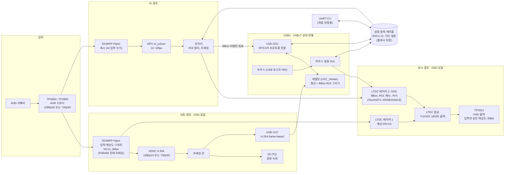

# 제품 구상 (Product Conception)

> 상태: **구상 (2026-11-14)**. 방향이 확정되면 `docs/prd.md`로 옮긴다. 아직 코드·PRD에는 반영하지 않았다.
> 확인이 필요한 하드웨어 사항은 6장에 모았다.

## 1. 한 줄 요약

AHD 카메라 1채널을 받아 **원본 녹화(SD) + AI 추론 + AHD 출력(OSD 포함)** 을 항상 하고, 태블릿이 연결되면 **UVC로 같은 녹화 스트림을 함께 보내는** 단일 펌웨어. 제품을 UVC/LCD로 나누지 않는다.

## 2. 블록도

- **파란 경로(녹화)** 에는 OSD가 없다. SD 녹화와 UVC는 같은 인코딩 스트림을 쓴다(인코딩 1회).
- **표시 경로** 만 OSD(BBox, ROI, 메뉴, 커서)가 합성되어 AHD로 나간다.
- 태블릿 화면의 BBox·ROI는 영상에 그려져 오지 않고, CDC로 받은 좌표를 태블릿이 그린다.

## 3. 해상도는 입력을 따른다

입력 해상도를 감지해 녹화·UVC·AHD 출력이 모두 따라간다. 해상도를 섞지 않는다(1080은 1080, 720은 720).

| 입력 (TP2850/2860) | Pipe1 | 녹화(SD)·UVC | AHD 출력 (TP2912) | AI 입력 (Pipe2) |
| --- | --- | --- | --- | --- |
| 1080p30 | 1920×1080 NV12 30fps | **1080p15** H.264 (2프레임 중 1개 인코딩) | 1080p30 | 모델 입력 크기로 축소 |
| 720p30 | 1280×720 NV12 30fps | **720p30** H.264 | 720p30 | 모델 입력 크기로 축소 |

- 1080p 녹화를 15fps로 두는 이유: VENC 부하와 SD 용량. 1080p30 녹화가 필요하면 VENC 여유와 PSRAM 대역폭(5장)을 실측한 뒤 정한다.
- 입력 해상도가 바뀌면(카메라 교체) 파이프라인 전체를 다시 설정한다. 녹화 파일은 그 시점에서 나눈다. 이미 `video_cfg`(해상도·fps 설정값)로 두기로 한 1단계 제약과 같다.
- AHD 출력은 항상 30fps라 1080p 입력일 때도 화면은 30fps로 부드럽다. 녹화·UVC만 15fps.
- OSD와 ROI 좌표는 해상도에 맞춰 변환한다(4.3).

## 4. 동작

### 4.1 USB1 상대에 따라 (USB-C CC 판별)

| 꽂힌 것 | 보드 역할 | 동작 |
| --- | --- | --- |
| 태블릿 (UVC_Viewer) | USB 장치: CDC(IF0-1) + UVC(IF2-3) | 녹화 스트림을 UVC로 함께 전송, 태블릿에서 설정 (CDC 프로토콜) |
| 마우스 (USB-C OTG 젠더) | USB 호스트: HID, VBUS 5 V 공급 | 설정 모드: OSD에 메뉴바, ROI 꼭짓점 원형 핸들, 커서 |
| 없음 | - | 녹화 + AI + AHD 출력만 |

- 녹화·AI·AHD 출력은 USB 상태와 상관없이 **항상** 돈다. 태블릿을 꽂고 빼도 영상이 끊기지 않는다.
- 태블릿 연결 중에는 마우스를 쓸 수 없다(같은 포트). 설정은 태블릿이 맡는다. 두 번째 USB 포트를 쓸지는 6장.
- 마우스를 빼면 설정 모드를 끝내고 메뉴·핸들·커서를 숨긴다.

### 4.2 설정의 원본은 보드

- 설정 항목 테이블 하나를 CDC 프로토콜(태블릿), 마우스 GUI(OSD), UART CLI가 함께 쓴다. 어디서 바꿔도 같은 값이다.
- 태블릿 프로토콜은 `2701_UVC_VIEWER/UVC_Viewer/docs/protocol.md`를 따른다(스키마·VALUES·SET·CHANGED·AREAS). 마우스나 CLI로 바꾸면 연결된 태블릿에 `CHANGED`를 보낸다.
- 보드가 원본이므로 설정과 ROI는 **플래시에 저장**한다(전원을 꺼도 유지).

### 4.3 좌표

| 쓰는 곳 | 기준 |
| --- | --- |
| 저장·프로토콜 | 영상 정수 픽셀, 왼쪽 아래 원점 (UVC_Viewer 규약, 1080p: (0,0)~(1920,1080), 720p: (0,0)~(1280,720)) |
| OSD (LTDC) | 출력 픽셀, 왼쪽 위 원점 |
| AI 입력 | 축소·여백(letterbox) 좌표 |

변환은 한 모듈에서만 한다. 입력 해상도가 바뀌면 저장된 ROI는 비율로 다시 맞춘다.

## 5. 자원 예산 (가늠, 실측 필요)

1080p30 입력 기준 PSRAM 사용 (NV12 1프레임 약 3.1 MB):

| 사용처 | 대략 |
| --- | --- |
| Pipe1 쓰기 30fps | 93 MB/s |
| LTDC 영상 레이어 읽기 30 Hz | 93 MB/s |
| OSD 레이어(ARGB4444) 읽기 + 그리기 | 70~100 MB/s |
| VENC 15fps (입력 + 참조 프레임) | 100~150 MB/s |
| AI, SD, 기타 | 수십 MB/s |
| **합계** | **약 350~450 MB/s** |

- OSD를 ARGB8888(1080p 8.3 MB/프레임)로 하면 그것만 약 250 MB/s라 넘칠 수 있다. ARGB4444 또는 L8(팔레트)로 한다.
- 720p30 입력은 1080p의 약 0.44배 화소지만 녹화가 30fps라 VENC 부하는 1080p15와 비슷하다.
- **장치 내부 지연(UVC)**: 표시 경로가 같은 프레임을 써야 해서 지금의 DCMIPP–VENC 줄 버퍼 핸드셰이크를 쓸 수 없다. 전체 프레임 버퍼를 거치므로 현재 27.6 ms보다 늘어난다(1080p15 기준 대략 70~100 ms 예상). 1단계 목표(50 ms)를 다시 정해야 한다.

## 6. 확인할 것

| 번호 | 항목 | 왜 |
| --- | --- | --- |
| H-1 | TP2850/TP2860 출력이 MIPI CSI-2인지 BT.656/BT.1120 병렬인지 | DCMIPP 입력 설정·핀이 완전히 다르다 |
| H-2 | TP2912 입력 형식(BT.1120 16비트 내장 동기 / 별도 HS·VS)과 N6 LTDC의 YCbCr 4:2:2 출력 지원 | 블록도의 "YUV422 16비트" 경로가 성립하는지 |
| H-3 | LTDC 픽셀 클럭 74.25 MHz(720p60 타이밍/1080p30) 가능 여부 | AHD 출력 타이밍 |
| H-4 | DK에서 디코더 보드 연결 방법(MIPI CSI 커넥터 어댑터 등) | 개발 보드 시험 |
| H-5 | 태블릿과 마우스를 USB1 하나로 할지, USB2를 따로 쓸지 | 태블릿 연결 중 마우스 사용 여부 |
| H-6 | DK에서 USB1이 VBUS 5 V를 낼 수 있는지 실제 확인 | 마우스 전원 (BSP에는 Source 기능이 있음) |
| S-1 | PSRAM 대역폭 실측 (5장) | 동시 동작의 가장 큰 위험 |
| S-2 | st_yoloxn 입력 크기와 Pipe2 축소·letterbox | AI 정확도·속도 |
| S-3 | 장치 내부 지연 목표 재설정 | 줄 버퍼 핸드셰이크를 못 쓰게 됨 |
| S-4 | 설정·ROI 플래시 저장 시점과 위치(외부 NOR) | 보드가 설정 원본 |

## 7. 지금 펌웨어(1단계)에서 바뀌는 것

| 지금 | 구상 |
| --- | --- |
| IMX335 + ISP(AE/AWB) | AHD 디코더 YUV 입력, ISP 불필요. `cam ae/exp/gain/awb` 설정은 없어지거나 디코더 설정으로 바뀜 |
| 720p30 고정 | 입력(1080p30/720p30)을 따라감 |
| DCMIPP–VENC 줄 버퍼 핸드셰이크 | PSRAM 전체 프레임 (VENC와 LTDC가 공유) |
| CDC 텍스트 CLI | CDC는 바이너리 프로토콜 전용, CLI는 UART |
| 설정 저장 없음 | 플래시 저장 |
| UVC가 유일한 출력 | 출력은 SD 녹화·AHD·UVC, UVC는 태블릿 연결 때만 |

유지되는 것: 인코더 출력 → 프레임 큐 → 소비자(SD, UVC) 구조, 설정 항목 테이블, USB composite(CDC+UVC, IAD), 해상도·fps 설정값화.
