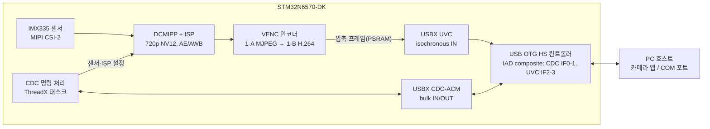

# PRD: STM32N6 1CH AI DVR — 전체 로드맵 + 1단계(UVC 카메라 + USB CDC)

작성일: 2026-11-13 · 개정: 2026-11-14 (제품 방향 변경, `docs/Product Conception.md`)

## 1. 개요

### 1.1 최종 제품

AHD 카메라 1채널을 받아 **녹화(SD, OSD 없음) + AI 사람 인식 + AHD 출력(OSD 포함)** 을 항상 하고, 태블릿(UVC_Viewer 앱)이 연결되어 영상을 열면 **UVC로 녹화 스트림을 함께 보내는** 1CH AI DVR. 제품을 UVC용/화면용으로 나누지 않고 펌웨어 하나로 만든다. 자세한 구조·검토·확인 항목은 `docs/Product Conception.md`가 기준이다.

- **입력**: 커스텀 보드는 TP2850(AHD 디코더, MIPI CSI-2). DK 보드에서는 IMX335.
- **출력**: 커스텀 보드는 LTDC YUV422 → TP2912(AHD). DK 보드에서는 DK LCD(800×480).
- **해상도는 입력을 따른다**: 1080p30 입력이면 AHD 출력 1080p30, 녹화는 LCD 모드 1080p15 / UVC 모드 720p30. 720p30 입력이면 모두 720p30.
- **USB1(USB-C)**: 태블릿이면 USB 장치(UVC + CDC, CDC는 UVC_Viewer 바이너리 프로토콜 전용), 마우스면 USB 호스트(HID, 설정 모드). 커스텀 보드는 DRP + Try.SRC + DR_Swap으로 태블릿을 충전하면서 장치로 동작한다.
- **설정**: 설정 항목 테이블 하나를 CDC 프로토콜(태블릿)·마우스 GUI(OSD, TouchGFX)·UART CLI가 함께 쓰고, 플래시에 저장한다. 설정의 원본은 보드다.

이전 계획(4단계에서 UVC를 빼고 USB를 마우스 호스트로만 쓰는 DVR, CDC 텍스트 CLI)은 2026-11-14에 위와 같이 바뀌었다.

### 1.2 개발 보드와 커스텀 보드

| | DK 보드 (지금) | 커스텀 보드 (나중) |
| --- | --- | --- |
| 입력 | IMX335 MIPI CSI-2 RAW + ISP | TP2850 MIPI CSI-2, ISP 없음 |
| 화면 | DCMIPP Pipe2 → DK LCD 800×480 RGB | Pipe0 YUV422 → LTDC YUV422 출력 → TP2912 AHD |
| 인코딩 | Pipe1 NV12 줄 버퍼 + VENC 하드웨어 핸드셰이크 | 같음 |
| AI 입력 | 화면 프레임을 CPU/GPU2D로 축소 | Pipe2 |
| USB1 | 장치(태블릿) + 시험용 호스트(마우스) | DRP + Try.SRC + DR_Swap, 태블릿 충전 |

인코딩·녹화·UVC·AI·OSD·프로토콜·설정 코드는 DK에서 만들어 커스텀 보드로 그대로 옮긴다. 보드마다 다른 영상 입력·화면·AI 입력은 "영상 소스" 계층 뒤에 둔다(`Product Conception.md` 9장).

### 1.3 단계별 로드맵

| 단계 | 내용 | 다음 단계로 넘어가는 기준 | 상태 |
| --- | --- | --- | --- |
| **1단계 UVC 카메라 + CDC (2~10장)** | IMX335 → ISP → 720p30 H.264 → USB UVC, CDC CLI | 720p30 H.264가 PC와 태블릿에 끊김 없이 표시, CLI 동작 | M1~M5 완료, M6(플래시 부팅·안정화) 남음 |
| 2단계 SD 녹화 + UART CLI | 상시 녹화(파일 분할, 오래된 파일 덮어쓰기), 프레임 큐 소비자 2개(SD + UVC, 참조 카운트), CLI를 UART(USART1)로 이동 | 녹화 중 UVC 동시 동작, 24시간 연속 녹화에 프레임 누락 없음 | 예정 |
| 3단계 화면 + OSD + 마우스 설정 | DK LCD 출력(3중 버퍼), TouchGFX OSD(ROI·메뉴·커서, BBox 자리), USB 호스트 HID로 마우스가 꽂히면 설정 모드 | 마우스로 ROI A~D 편집, 녹화·화면 동시 동작 | 예정 |
| 4단계 태블릿 연동 | CDC를 UVC_Viewer 바이너리 프로토콜 전용으로(스키마·VALUES·SET·CHANGED·AREAS), UVC 모드 전환(1080p 입력), 설정·ROI 플래시 저장 | UVC_Viewer에서 영상 + 설정 + ROI 편집 | 예정 |
| 5단계 AI 사람 인식 | NPU st_yoloxn, 후처리(ROI 필터, 트래킹), 이벤트 기록, BBox를 OSD와 태블릿(프로토콜)에 표시. 녹화본에 BBox 없음 | 녹화·화면·UVC를 유지하며 AI 10fps 이상 | 예정 |
| 6단계 커스텀 보드 | TP2850 입력, TP2912 AHD 출력(LTDC YUV422), 1080p/720p 자동 전환, USB-C DRP + 태블릿 충전 | 커스텀 보드에서 전체 기능 동작 | 예정 |

- 진행 순서(2026-11-14 결정): **1단계 M6(플래시 부팅) → UVC_Viewer(별도 저장소)에서 H.264 UVC 표시 + 노트20 연결 확인 → 2단계 → 3단계(마우스·GUI) → 4단계(태블릿) → 5단계(AI는 마지막)** → 6단계 커스텀 보드. 뷰어 작업은 이 저장소 밖이다.
- AI를 마지막에 두므로 3·4단계의 OSD·프로토콜에는 BBox 자리만 만들어 두고, 5단계에서 채운다. DK의 AI 입력은 화면 프레임 축소라(`Product Conception.md` 9장) 화면(3단계)이 먼저 있는 편이 맞다.
- DK에서 미리 잴 수 있는 위험(1080줄 핸드셰이크 H-10, PSRAM 대역폭 S-1)은 2~3단계 중에 IMX335 1080p로 측정한다. AI가 빠진 상태의 대역폭이므로 5단계에서 다시 잰다.
- 2단계 이후 각 단계의 상세 요구사항은 그 단계를 시작할 때 이 문서에 장을 추가한다(11장에 현재 개요).

### 1.4 설계 제약 (지금부터 지킨다)

- 카메라·인코더를 UVC에 묶지 않는다. 인코더 출력은 ‘프레임 큐’로 내보내고, SD 녹화와 UVC는 그 큐의 소비자다. 느린 소비자(SD)가 UVC를 막지 않는다.
- 해상도·fps는 설정값이다. 입력 해상도와 모드(UVC/LCD)에 따라 실행 중에 바뀐다.
- 녹화는 OSD(BBox 등) 없는 원본이다. OSD는 LTDC 레이어 2에만 그리고, 인코더 입력에는 절대 그리지 않는다. 태블릿 화면의 BBox·ROI는 CDC로 받은 좌표를 태블릿이 그린다.
- DCMIPP 파이프는 역할을 하나씩 맡는다: 인코딩(Pipe1), AI(Pipe2), 화면(커스텀 보드 Pipe0 / DK Pipe2 공유).
- 설정 항목 테이블을 CLI·프로토콜·GUI가 함께 쓴다. 명령 처리와 테이블을 분리해 둔다.
- 보드에 따라 다른 부분(영상 입력, 화면, AI 입력, USB-C 전원 역할)은 한 계층 뒤에 둔다.

## 1단계 상세 (2~10장)

2~10장은 **1단계(UVC 카메라 + CDC)** 의 요구사항과 결과다. 1단계 범위는 DK 보드에서 동작하는 펌웨어 프로토타입이다.

- **1단계 개요**: STM32N6570-DK와 IMX335 카메라 모듈로 1280×720 30fps를 보내는 USB UVC 카메라를 만든다. 먼저 MJPEG로 영상이 나오는지 확인하고(1-A), 그다음 H.264로 바꿔 확정한다(1-B). 같은 USB 케이블 하나에 CDC-ACM 가상 COM 포트를 함께 올려, 카메라 제어와 상태 조회를 할 수 있게 한다.
- **배경**: N6에는 MIPI CSI-2, DCMIPP와 ISP, 하드웨어 비디오 인코더(VENC, H.264/JPEG), USB 2.0 HS가 모두 들어 있다. 그래서 외부 브리지 칩 없이 단일 MCU로 UVC 카메라를 만들 수 있다.
- **용어**: UVC = USB Video Class, CDC-ACM = USB 가상 시리얼 포트, VC/VS = VideoControl/VideoStreaming 인터페이스, IAD = Interface Association Descriptor.

## 2. 목표와 비목표

PC에 드라이버를 따로 설치하지 않고도 표준 카메라와 COM 포트로 동시에 인식되는 것이 핵심 목표다.

**목표**

1. 하나의 USB HS 포트에서 UVC와 CDC-ACM을 합친 composite 장치로 인식된다.
2. 1280×720 30fps 영상을 끊김 없이 보낸다. 1-A는 MJPEG, 1-B는 H.264다.
3. Windows 10/11과 Linux(UVC 드라이버)의 기본 드라이버만으로 영상과 COM 포트가 모두 동작한다.
4. CDC로 카메라 설정(노출, 화이트밸런스 등)과 상태(fps, 온도, 오류)를 주고받는다.
5. 영상 스트리밍 중에도 CDC 통신이 끊기거나 느려지지 않는다.

**비목표(이번 버전에서 하지 않음)**

- 무압축(YUY2/NV12) 720p30 전송: USB HS 대역폭을 넘어서 불가능하다(5장 참고).
- Linux 호스트에서의 개발·검증: 개발은 Windows PC 기준으로 한다.
- 1080p, SD 카드 녹화, AI 사람 인식, 화면 출력과 마우스 UI, 태블릿 프로토콜, 커스텀 보드: 2~6단계에서 다룬다(1.3). 오디오(UAC)는 계획에 없다.
- USB 외의 물리 UART 브리지(필요하면 10장 미결 사항에서 결정).

## 3. 사용 시나리오

주 사용자는 개발 중인 펌웨어를 검증하는 개발자다. 개발과 디버깅은 Windows PC에서 하고(영상과 CDC를 한 대에서 동시에 확인), 최종 확인은 UVC 뷰어 앱을 설치한 태블릿에서 한다.

| # | 상황 | 사용자 행동 | 기대 결과 |
| --- | --- | --- | --- |
| S1 | 처음 연결 | USB-C 케이블로 PC에 꽂는다 | 5초 안에 카메라 1개와 COM 포트 1개가 장치 관리자에 나타난다 |
| S2 | 영상 확인 | Windows PC에서 카메라 앱이나 VLC를 연다. 최종 확인은 태블릿에 USB-C(OTG)로 연결해 UVC 뷰어 앱으로 한다 | 720p30(1-A MJPEG, 1-B H.264)이 선택 목록에 보이고 재생된다 |
| S3 | 설정 변경 | 터미널(Tera Term 등)이나 자체 앱에서 CDC로 명령을 보낸다 | 영상이 멈추지 않고 설정이 바로 반영되며 응답이 온다 |
| S4 | 상태 감시 | 호스트가 주기적으로 상태를 요청한다 | fps, 프레임 크기, 오류 카운터를 받는다 |
| S5 | 재연결 | 케이블을 뽑았다 다시 꽂거나 호스트가 절전 모드에서 깨어난다 | 보드 리셋 없이 다시 인식되고 스트리밍이 재개된다 |

## 4. 기능 요구사항

P0은 PoC에 반드시 들어가야 하는 기능이고, P1은 있으면 좋은 기능, P2는 후속 버전에서 할 기능이다.

| ID | 영역 | 요구사항 | 우선순위 |
| --- | --- | --- | --- |
| F-01 | USB | 하나의 USB OTG HS 포트에서 CDC-ACM(인터페이스 2개)과 UVC(VC/VS 인터페이스 2개)를 IAD로 묶은 composite 장치로 인식된다 | P0 |
| F-02 | UVC (1-A) | UVC 1.1 MJPEG 포맷 디스크립터로 1280×720 30fps를 제공한다. Windows 카메라 앱과 태블릿 뷰어에서 별도 설정 없이 재생되어야 한다. 1-B(H.264)가 성공하면 MJPEG 디스크립터·코드·CLI 명령을 영구 삭제한다(삭제 전 코드는 git 태그 `m3-mjpeg-ref`로 보존). **2026-11-13 M4-7에서 삭제 완료** | P0 |
| F-03 | UVC (1-B) | H.264 포맷 디스크립터로 1280×720 30fps를 제공한다. 페이로드 방식(UVC 1.5 H.264, UVC 1.1 frame-based H.264, MPEG-2 TS)은 M4에서 Windows와 태블릿 호환성 시험 후 확정한다. **확정(M4-5): UVC 1.1 frame-based H.264**(형식 1개, GUID `H264`). 노트20 뷰어와 Windows ffmpeg에서 재생 확인 | P0 |
| F-04 | UVC | 호스트의 Probe/Commit 요청에 응답하고, 스트림을 열고 닫을 때 카메라와 인코더를 시작/정지한다. H.264는 스트림 시작 시 SPS/PPS와 IDR 프레임부터 보낸다 | P0 |
| F-05 | UVC | 밝기, 대비, 화이트밸런스 등 UVC 표준 Processing Unit 컨트롤을 지원한다 | P2 |
| F-06 | 카메라 | IMX335를 MIPI CSI-2로 받아 DCMIPP와 ISP를 거쳐 1280×720 YUV를 만든다(센서 출력에서 크롭 또는 다운스케일) | P0 |
| F-07 | 카메라 | 자동 노출(AE)과 자동 화이트밸런스(AWB)가 동작한다 | P0 |
| F-08 | 인코딩 (1-A) | ~~하드웨어로 MJPEG를 만든다(VENC JPEG 모드). 품질(Q) 값을 바꿀 수 있다~~ → M4-7에서 삭제 | — |
| F-09 | 인코딩 (1-B) | VENC로 H.264를 만든다. Baseline 또는 Main profile, Level 3.1, B-프레임 없음(I/P만), 기본 CBR 4 Mbps, IDR 주기 기본 30프레임(1초), 명령 시 즉시 IDR. 저지연 설정: lookahead 없음, 작은 비트레이트 버퍼, 인코딩이 끝난 프레임은 즉시 전송, DCMIPP–VENC 하드웨어 핸드셰이크(프레임이 다 들어오기 전에 인코딩 시작, M4-6에서 적용) | P0 |
| F-10 | CDC | PC에서 표준 COM 포트로 열리고, 기본 설정은 115200 8N1이다(USB에서는 설정값일 뿐 실제 속도를 제한하지 않는다) | P0 |
| F-11 | CDC | 7장의 CLI(프롬프트, 에코, help)로 설정 조회/변경과 상태 조회를 처리한다 | P0 |
| F-12 | CDC | 디버그 로그를 CDC로 출력한다(레벨 설정 가능) | P1 |
| F-13 | 시스템 | 케이블 분리/재연결, 호스트 suspend/resume 후 리셋 없이 복구한다 | P0 |
| F-14 | 시스템 | 펌웨어를 외부 플래시에 굽고 전원만 넣으면 부팅한다(FSBL + 앱) | P1 |
| F-15 | 시스템 | 보드 LED로 상태(대기/스트리밍/오류)를 표시한다 | P2 |

## 5. 비기능 요구사항

720p30은 압축해야만 USB HS에 들어간다. 1-A의 MJPEG는 USB 한계의 12~24%, 1-B의 H.264는 약 2%를 쓴다. 둘 다 여유가 있다.

**대역폭 계산**

| 포맷 | 프레임당 크기 | 30fps 대역폭 | USB HS isochronous 한계(24.6 MB/s) 대비 |
| --- | --- | --- | --- |
| YUY2 무압축 | 1,843,200 B | 55.3 MB/s | 225%, 불가 |
| NV12 무압축 | 1,382,400 B | 41.5 MB/s | 169%, 불가 |
| MJPEG Q 75~85 (1-A) | 100~200 KB | 3~6 MB/s | 12~24%, 가능 |
| H.264 CBR 4 Mbps (1-B) | 평균 약 17 KB, IDR은 수 배 | 0.5 MB/s | 약 2%, 가능 |

USB HS isochronous 한계는 마이크로프레임(125 µs)마다 3 × 1024바이트를 보내는 high-bandwidth 설정 기준 이론값이다. H.264 비트레이트는 화질을 보며 2~8 Mbps 범위에서 PoC 중에 정한다. IDR 프레임은 P 프레임보다 수 배 크므로 출력 버퍼와 dwMaxVideoFrameBufferSize는 IDR 기준으로 잡는다.

**품질 목표**

| 항목 | 목표치 | 측정 방법 |
| --- | --- | --- |
| 프레임레이트 | 30fps ± 0.5, 1시간 평균 | 호스트 타임스탬프 기록, CDC 상태 카운터 |
| 프레임 드롭 | 1시간에 0.1% 이하 | 호스트 측 수신 카운트 대비 장치 송신 카운트 |
| 지연(glass-to-glass) | 100 ms 이하, 그중 장치 내부(캡처 시작 → USB 전송 완료) 50 ms 이하 | 스톱워치 화면을 카메라와 모니터에 함께 찍어 비교. 장치 내부는 CLI status의 지연 측정값 |
| 인식 시간 | 연결 후 5초 이내 | 수동 측정 10회 |
| CDC 응답 | 스트리밍 중 명령 응답 50 ms 이하 | 호스트 스크립트 1,000회 왕복 |
| 연속 동작 | 24시간 무중단 스트리밍 | soak 테스트 |
| 재연결 | 분리/연결 100회 중 100회 복구 | 자동 USB 스위치 또는 수동 |

**호환성**

- 개발 호스트: Windows 10/11 PC(카메라 앱, VLC, 장치 관리자, USB Device Tree Viewer, Wireshark + USBPcap). 최종 확인 호스트: USB OTG를 지원하는 Android 태블릿 + UVC 뷰어 앱. Android 앱은 자체 유저스페이스 UVC 드라이버를 쓰므로, H.264 UVC 지원 여부는 앱마다 다르다(예: ShenYao의 USB Camera 앱은 H.264 UVC를 지원한다고 밝힌다). Linux는 사용하지 않는다.
- 확인할 앱: Windows 카메라 앱·VLC(개발 중), 태블릿의 UVC 뷰어 앱(단계마다 최종 확인).
- 호스트 포트: USB 2.0 HS 이상. USB 3.x 포트와 허브에서도 동작해야 한다.

## 6. 시스템 아키텍처

카메라 영상과 CDC 명령은 각자 따로 처리되다가, 하나의 USB OTG HS 컨트롤러에서 composite 장치로 합쳐진다.



영상은 센서에서 ISP와 VENC 인코더(1-A MJPEG, 1-B H.264)를 거쳐 UVC로 한 방향으로만 흐른다. CDC 명령은 양방향으로 오가고, 필요하면 센서와 ISP 설정을 바꾼다.

**버퍼 구성(안)**: DCMIPP 출력 NV12 프레임(1280×720×1.5 = 약 1.4 MB) 2개, VENC 참조 프레임과 작업 버퍼, H.264 출력 비트스트림 버퍼(각 512 KB) 2개를 외부 PSRAM에 둔다. [ST 위키](https://wiki.st.com/stm32mcu/wiki/Introduction_to_Hardware_Video_Encoding_with_STM32) 기준 720p에서 입력 프레임 2개가 2.64 MB, 참조 프레임과 VENC 버퍼가 2.92 MB로, 합계 약 6 MB를 확보한다.

**1-A 실제 구성(M3)**: VENC JPEG 입력이 YUV422 인터리브(YUYV)라서 DCMIPP 출력은 YUV422(1280×720×2 = 1.8 MB)다. 캡처 버퍼 3개(최대 1080p 크기로 각 4 MB, 인코딩 중인 버퍼를 덮어쓰지 않게 하나 더 둠), 인코딩 프레임 큐 4×512 KB, VENC 작업 메모리 256 KB로 약 14 MB를 PSRAM에 둔다. PSRAM은 MPU 비캐시. 1-B에서 NV12·H.264 버퍼로 다시 잡는다.

**1-B 실제 구성(M4-6/M4-7)**: DCMIPP PIPE1 출력은 NV12(YUV420 semi-planar)이고, 프레임 버퍼 대신 64줄짜리 줄 버퍼(최대 1080p 폭 기준 180 KB)를 내부 SRAM(AXISRAM2 아래쪽, 개발 모드)에 둔다. DCMIPP가 32줄마다 VENC에 하드웨어 신호를 주어 캡처와 인코딩이 겹친다(VENC_USB 720p_Slice와 같은 방식). PSRAM에는 VENC 작업 메모리(6 MB)와 인코딩 프레임 큐(4×512 KB)만 둔다. M6 플래시 부팅 때 줄 버퍼 위치를 다시 정한다.

**USB 디스크립터 구성(안)**: 엔드포인트 번호는 제안값이며 예제 코드에 맞춰 조정한다.

| 인터페이스 | 클래스 | 엔드포인트 | 용도 |
| --- | --- | --- | --- |
| IAD 1 → IF0 | CDC Communication | 0x82 Interrupt IN | 시리얼 상태 알림 |
| IAD 1 → IF1 | CDC Data | 0x01 Bulk OUT, 0x81 Bulk IN (512 B) | 명령, 응답, 로그 |
| IAD 2 → IF2 | UVC VideoControl | EP0만 사용 | 카메라 제어 요청, VC header의 baInterfaceNr = 3. bcdUVC = 0x0110(1-B도 UVC 1.1 frame-based로 확정) |
| IAD 2 → IF3 alt 0 | UVC VideoStreaming | 없음 | 스트림 대기(대역폭 0). H.264 frame-based 포맷·프레임 디스크립터(형식 1개, M4-7에서 MJPEG 삭제)가 여기 들어간다 |
| IAD 2 → IF3 alt 1~ | UVC VideoStreaming | 0x83 Isochronous IN | 1024 B × 3(high-bandwidth, 마이크로프레임당 3 KB, 최대 약 24 MB/s), USB DMA 사용. M3 결정 변경: ×1·DMA 미사용(slave)은 하단 깨짐과 프레임당 전송 약 40 ms(25 fps)로 실패. x-cube-n6-camera-capture와 같은 구성 |

## 7. CDC CLI 초안

> **방향 변경(2026-11-14)**: 이 CLI는 1단계에서 CDC로 동작 중이다. 2단계에서 **UART(USART1)로 옮기고**, 4단계부터 CDC는 UVC_Viewer 바이너리 프로토콜 전용이 된다(`2701_UVC_VIEWER/UVC_Viewer/docs/protocol.md`). 명령 형식·설정 항목 테이블은 그대로 쓴다. 입력이 AHD 디코더로 바뀌는 커스텀 보드에서는 `cam ae/exp/gain/awb`가 없어지거나 디코더 설정으로 바뀐다.

1단계의 CDC는 Tera Term 같은 터미널에서 사람이 직접 치는 CLI(명령줄) 형식으로 만든다. 프롬프트에서 `<그룹> <명령> [인수]`를 치면 사람이 읽기 쉬운 결과가 나오고, 마지막 줄은 항상 `OK` 또는 `ERROR: <이유>`다. 마지막 줄 규칙 덕분에 나중에 PC 스크립트로 자동 시험도 할 수 있다.

- **프롬프트**: `n6uvc> `. 포트를 열면(DTR=1) 펌웨어 버전 배너와 프롬프트를 보여 준다.
- **입력**: 장치가 글자를 그대로 되돌려 보여 준다(에코). Enter(CR 또는 CRLF)로 실행, Backspace로 지우기, Ctrl+C로 줄 취소. 위 화살표 이력은 P1이다.
- **문법**: 대소문자를 구분하지 않고, 띄어쓰기로 구분한다. 줄 길이는 최대 128자. 인수 없이 치면 현재값을 보여 준다(예: `cam exp`).
- **도움말**: `help`는 그룹 목록, `help <그룹>`은 그 그룹의 명령과 인수 범위를 보여 준다.
- **로그**: 디버그 로그(주기 통계, 연결/해제 등)는 USART1(ST-LINK 가상 COM)로만 나가고 CDC에는 비동기 로그가 없다(M5). 나중에 CDC로 비동기 로그를 보내게 되면, 입력 중인 줄을 지우고 출력한 뒤 프롬프트와 입력을 다시 그린다.
- **line coding**: 터미널에서 고른 baud rate는 저장만 하고 동작에는 영향을 주지 않는다. 설정 표시는 115200 8N1이다.

명령 예:

```text
n6uvc> status
stream   : on   H264 1280x720@30
fps      : cap 30.0  enc 30.0  usb 30.0  (5 s avg)
bitrate  : 4.1 Mbps  (target 4000 kbps, gop 30)
latency  : 27.6 ms avg, 30.9 ms max  (capture -> USB done)
drop     : late 0  noslot 0  queue 3  wait-idr 2  desync 0  encerr 0
usb loss : isoinc 1  buferr 0
camera   : ae on  awb on  exp 23814 us  gain 12.3 dB
OK
n6uvc> cam exp 10000
ERROR: cam exp: auto mode is on (turn it off first)
n6uvc> cam ae off
cam ae : off
OK
n6uvc> cam exp 10000
cam exp : 10000 us
OK
n6uvc> enc bitrate 9000
ERROR: bitrate range is 1000-8000 kbps
n6uvc>
```

| 명령 | 설명 | 단계 |
| --- | --- | --- |
| `help [그룹]` | 명령 목록과 사용법 | 공통 |
| `version` | 펌웨어 버전, 빌드 날짜 | 공통 |
| `status` | 스트리밍 여부, 포맷·해상도, 현재 fps, 비트레이트, 드롭 수, 패킷 손실 수 | 공통 |
| `cam ae [on\|off]` | 자동 노출 켜기/끄기 | 공통 |
| `cam exp [us]` | 수동 노출 시간 조회/설정(10~33000). AE가 꺼져 있어야 설정 가능 | 공통 |
| `cam gain [dB]` | 수동 게인 조회/설정(0.0~72.0, 0.1 dB 단위). AE가 꺼져 있어야 설정 가능 | 공통 |
| `cam awb [on\|off]` | 자동 화이트밸런스 켜기/끄기(끄면 그때 고른 색온도로 고정) | 공통 |
| `enc bitrate [kbps]` | H.264 목표 비트레이트 조회/설정(1000~8000). 바꾸면 인코더를 다시 만든다(프레임 1~2장 빠짐, 다음은 IDR) | 1-B |
| `enc gop [frames]` | IDR 주기 조회/설정(1~300, 기본 30). 바꾸면 인코더를 다시 만든다 | 1-B |
| `enc idr` | 다음 프레임을 IDR로 강제 | 1-B |
| `log level [0-3]` | USART1 주기 통계 레벨(0 끔, 1 VIDEO, 2 +UVC, 3 +UVCPAY·LAT, 기본 3). 사건 로그는 항상 | 공통 |
| `reboot` | 시스템 전체 리셋(USB 재연결, 플래시에서 다시 부팅). 개발 모드에서는 보드가 멈추므로 디버거로 다시 실행한다 | 공통 |

설정값 저장(전원을 꺼도 유지)은 1단계에서 하지 않는다(4단계에서 플래시 저장). 3단계 마우스 메뉴와 4단계 태블릿 프로토콜이 같은 설정 항목을 쓰게 되므로, 명령 처리는 ‘설정 항목 테이블’과 분리해 둔다. 그러면 나중에 메뉴가 같은 테이블을 쓸 수 있다.

**구현(M5)**: `fw/App/`. `settings.c`가 설정 항목 테이블(그룹·이름·형식·범위·단위·설명·get/set)이고, `cli.c`는 이 테이블로 `<group> <name> [value]` 명령과 `help <group>`을 자동으로 만든다. 항목을 늘릴 때는 테이블에 한 줄을 더한다. 내장 명령(help, version, status, reboot, enc idr)만 `cli.c`에 있다. CDC CLI 스레드(`ux_device_cdc_acm.c`)는 읽기에서 계속 기다리고, 터미널이 포트를 열면(DTR 0→1) 별도 배너 스레드가 배너와 프롬프트를 보낸다. 터미널 표시 문자열은 영문이다.

## 8. 개발 환경과 참고 자료

ST가 공개한 예제 세 개를 합치는 방식으로 개발한다. 처음부터 새로 짤 부분은 composite 디스크립터와 CDC 명령 처리뿐이다.

| 항목 | 내용 |
| --- | --- |
| 보드 | STM32N6570-DK, MB1939-N6570-C02 |
| 카메라 | MB1854B IMX335 모듈(B-CAM-IMX) |
| USB 데이터 포트 | USB1 = CN18 (UVC·CDC용 USB OTG HS) |
| 케이블 | USB-C 2개: ST-LINK(CN6) 전원·디버그용, USB OTG HS 데이터용 |
| IDE | STM32CubeIDE 또는 IAR EWARM, STM32CubeMX |
| 펌웨어 패키지 | STM32CubeN6 (최신 버전), ThreadX + USBX |
| 프로그래머 | STM32CubeProgrammer (외부 플래시용 External Loader 포함) |
| 디버깅 도구 | Wireshark + USBPcap(Windows), usbmon(Linux), USB Device Tree Viewer |

**참고할 예제**

- [x-cube-n6-ai-h264-usb-uvc](https://github.com/STMicroelectronics/x-cube-n6-ai-h264-usb-uvc): ST의 카메라 → VENC(H.264) → USB UVC 예제. 1-B의 출발점이다(AI 부분은 제외).
- STM32CubeN6 VENC_USB: VENC H.264 스트림을 UVC로 보내는 예제. [Windows 카메라·VLC에서 안 보이는 문제와 ST 답변](https://community.st.com/stm32-mcus-embedded-software-32/venc-usb-uvc-stream-not-showing-in-windows-camera-or-vlc-stm32n6570-dk-157106)도 함께 본다.
- [Introduction to Hardware Video Encoding with STM32 (ST 위키)](https://wiki.st.com/stm32mcu/wiki/Introduction_to_Hardware_Video_Encoding_with_STM32): VENC 구조, 메모리 요구량, 성능.
- [x-cube-n6-camera-capture](https://github.com/STMicroelectronics/x-cube-n6-camera-capture): IMX335 → ISP → USB UVC 흐름. 카메라·ISP 코드를 가져온다.
- [STM32CubeN6 Ux_Device_Video](https://github.com/STMicroelectronics/STM32CubeN6/tree/main/Projects/STM32N6570-DK/Applications/USBX/Ux_Device_Video): 카메라 없이 MJPEG 스트림을 보내는 USBX UVC 예제. 1-A의 출발점이다.
- STM32CubeN6 USBPD_SNK_Ux_Device_HID_CDC_ACM: DK용 USBX CDC 예제(HID+CDC IAD composite). `Ux_Device_CDC_ACM`은 NUCLEO-N657X0-Q용만 있다(V1.4.1 기준).
- [How to implement the USB device composite class (ST 커뮤니티)](https://community.st.com/t5/stm32-mcus/how-to-implement-the-usb-device-composite-class-in-stm32-using/ta-p/645017): USBX composite 구성 방법.
- [CDC+UVC composite 인식 실패 사례 (ST 커뮤니티)](https://stcommunity.st.com/t5/stm32-mcus-embedded-software/stm32n6-usbd-composite-cdc-uvc-failed-to-enumerate-under-windows/td-p/887985): VC/VS 인터페이스 번호가 고정되어 생기는 문제와 해결책.

## 9. 마일스톤과 검증 기준

1단계의 마일스톤이다. M1~M5는 완료했다(`docs/progress.md`). 순서대로 진행하고, 각 단계의 완료 기준을 통과해야 다음 단계로 넘어간다. 일정은 아직 정하지 않았다(10장).

1. **M1 환경 구축과 예제 확인 (Windows PC)**
    - 작업: Ux_Device_Video(MJPEG), x-cube-n6-camera-capture, USBPD_SNK_Ux_Device_HID_CDC_ACM(DK용 CDC 예제)을 각각 빌드하고 굽는다. 절차는 `docs/m1-guide.md`.
    - 완료 기준: 세 예제가 Windows PC에서 동작하고, 태블릿 뷰어에서도 MJPEG 예제 영상이 나오는지 확인한다.
2. **M2 composite 인식(MJPEG 가짜 영상)**
    - 작업: CDC + UVC composite 디스크립터를 만들고, UVC는 고정 MJPEG 이미지를 보낸다.
    - 완료 기준: Windows에서 카메라와 COM 포트가 동시에 동작하고 CDC 에코 테스트가 통과한다.
3. **M3 실제 카메라 MJPEG 720p30 (1-A 완료)**
    - 작업: IMX335 → DCMIPP/ISP → 하드웨어 JPEG → UVC 파이프라인을 연결한다.
    - 완료 기준: Windows 카메라 앱과 태블릿 뷰어에서 720p30 실영상이 끊김 없이 나온다.
4. **M4 H.264 전환과 페이로드 방식 확정 (1-B)**
    - 작업: 인코더를 VENC H.264로 바꾸고, 페이로드 방식 3가지를 Windows와 태블릿에서 비교한다. x-cube-n6-ai-h264-usb-uvc와 VENC_USB 예제를 참고한다.
    - 완료 기준: 태블릿 뷰어(필수)와 Windows(가능하면)에서 재생되는 방식을 하나 확정하고, 720p30 H.264 실영상이 100 ms 이내 지연으로 나온다. 그 뒤 MJPEG 디스크립터·코드·CLI 명령을 영구 삭제한다.
5. **M5 CDC 명령 구현** — 2026-11-14 완료
    - 작업: 7장 CLI를 구현하고 카메라·인코더 제어와 연결한다.
    - 완료 기준: 스트리밍 중 모든 명령이 50 ms 안에 응답하고 영상 끊김이 없다.
6. **M6 안정화와 검증**
    - 작업: 재연결·suspend 처리, 플래시 부팅, 5장 품질 목표 전체 측정.
    - 완료 기준: 24시간 soak 테스트와 재연결 100회를 통과한다.

## 10. 리스크와 미결 사항

가장 큰 리스크는 composite 디스크립터 오류로 UVC가 인식되지 않는 것(M2에서 MJPEG로 먼저 확인)과, 태블릿 앱이 H.264 UVC를 재생하지 못하는 것(M4)이다. MJPEG로 먼저 영상을 확보해 두면, H.264에서 막혀도 돌아갈 곳이 있다.

**리스크**

| 리스크 | 영향 | 대응 |
| --- | --- | --- |
| Windows 카메라 앱·VLC 등이 H.264 UVC 스트림을 재생하지 못함 | 장치는 인식되나 영상이 나오지 않음 | M4에서 페이로드 방식별로 대상 앱을 시험해 결정한다. ST는 Windows 호환을 위해 UVC 1.5와 MPEG-2 TS 포맷을 권고했다. MJPEG는 태블릿에서 H.264가 확인된 뒤에만 삭제하므로, 그 전에 막히면 MJPEG로 UVC 확인을 계속할 수 있다 |
| 호스트의 디코더·플레이어 버퍼링으로 지연이 100 ms를 넘음 | 장치가 빨라도 화면이 늦게 나옴 | 장치 내부 지연(50 ms 이하)을 따로 측정해 원인을 나눈다. VLC는 캡처 버퍼(기본 수백 ms)를 최소로 줄이고, 태블릿 앱은 M4에서 지연을 실측한다 |
| 스트림 시작 시 SPS/PPS·IDR이 빠짐 | 처음 몇 초간 화면이 검거나 깨짐 | Commit과 alt setting 변경 시 즉시 IDR을 강제하고 SPS/PPS를 매 IDR 앞에 붙인다 |
| isochronous 패킷 손실 | 다음 IDR까지 블록 노이즈가 이어짐 | IDR을 1초 주기로 넣고, 손실 카운터를 CLI `status` 명령으로 보여 준다 |
| 예제의 UVC 디스크립터에 VC/VS 인터페이스 번호(0/1)가 고정되어 있음 | CDC만 보이고 UVC는 인식되지 않음 | VC header의 baInterfaceNr, VS 모든 alternate setting의 번호를 동적으로 바꾼다. Wireshark로 디스크립터를 덤프해 확인한다 |
| ST의 UVC 라이브러리(uvcl)가 USB 스택 초기화를 직접 함 | composite 구성이 덮어써져 CDC가 동작하지 않음 | CubeMX가 만든 USBX composite 구조에 UVC 클래스를 직접 등록한다 |
| VENC 메모리·PSRAM 대역폭 부족 | fps 하락, 인코딩 오류 | 720p 기준 약 6 MB를 PSRAM에 확보하고 VENC_USB 예제의 메모리 배치를 따른다 |
| ISP 파라미터가 720p 크롭과 맞지 않음 | 검은 화면이나 색 왜곡 | x-cube-n6-camera-capture의 ISP 설정을 그대로 쓰고, 필요하면 X-CUBE-ISP로 튜닝한다 |
| N6에 내장 플래시가 없어 부팅 구조가 복잡함 | 개발 초기에 시간 소모 | 개발 모드로 시작하고, 플래시 부팅은 M6에서 예제 구조를 따른다 |

**미결 사항**

- [x] CDC 용도 확정 → 2026-11-14: 4단계부터 UVC_Viewer 바이너리 프로토콜 전용. 사람이 쓰는 CLI는 UART로 옮긴다
- [x] 태블릿 기종(USB OTG 지원)과 UVC 뷰어 앱 이름 확정, 그 앱의 MJPEG(M1)·H.264(M4) UVC 재생 여부 확인 → 2026-11-13: 갤럭시 노트20(One UI 5.1, Android 13) + ShenYao China "USB Camera" 12.3.2. 해상도 목록에 MJPEG·H.264 1280x720이 함께 보이고 둘 다 재생 확인(H.264는 UVC 1.1 frame-based)
- [ ] 태블릿 뷰어 앱의 디코딩·표시 지연 실측(100 ms 목표 달성 여부를 좌우, M4)
- [ ] H.264 페이로드 방식(UVC 1.5 H.264 / UVC 1.1 frame-based / MPEG-2 TS) 결정(M4)
- [ ] H.264 profile(Baseline/Main)과 기본 비트레이트 확정
- [x] 보유한 DK 보드 리비전과 카메라 모듈 확인: MB1939-N6570-C02, MB1854B (M1)
- [ ] 마일스톤별 일정과 담당자
- [ ] USB VID/PID(개발 중에는 ST VID 0x0483 + 임시 PID 0x5760(M2부터, Windows 드라이버 캐시 충돌 방지), 제품화 시 자체 발급)

**다음 단계를 위해 미리 정할 것**

- [x] 3단계 화면 출력 방식 → DK는 내장 LCD, 커스텀 보드는 LTDC YUV422 → TP2912 AHD (2026-11-14)
- [x] 마우스와 태블릿의 USB 포트 → USB1 하나를 USB-C 상대 판별로 나눠 쓴다(태블릿 = 장치, 마우스 = 호스트). 두 번째 포트를 쓸지는 `Product Conception.md` H-5
- [ ] 2단계 녹화 파일 형식(MP4 / TS)과 파일 분할 단위
- [ ] 5단계 사람 검출 모델 입력 해상도 (모델은 st_yoloxn, `Product Conception.md` S-2)
- [ ] 커스텀 보드 확인 항목 (`Product Conception.md` 7장 H-1~H-14)

## 11. 2단계 이후 개요 (초안)

각 단계를 시작할 때 이 장을 단계별 장으로 자세히 나눈다. 구조·근거는 `docs/Product Conception.md`.

| 단계 | 주요 작업 | 완료 기준(초안) | 함께 확인할 위험 |
| --- | --- | --- | --- |
| 2단계 SD 녹화 + UART CLI | DK microSD(SDMMC) + FileX, 파일 분할·덮어쓰기, 프레임 큐 참조 카운트(SD + UVC), SD 쓰기 멈춤 대비 2~3초 버퍼, CLI를 USART1로 이동 | 녹화하며 UVC 동시 재생, 24시간 녹화 프레임 누락 없음, 재생 가능한 파일 | IMX335 1080p로 1080줄 핸드셰이크(H-10)·PSRAM 대역폭(S-1) 측정 |
| 3단계 화면 + OSD + 마우스 | DK LCD(3중 버퍼, 클럭 드리프트 흡수), TouchGFX OSD(ARGB2222 검토), USB 호스트 HID, 마우스 연결 = 설정 모드(메뉴바, ROI 꼭짓점 원형 핸들, 커서) | 마우스로 ROI A~D 편집, 녹화·화면 동시 동작, LTDC underrun 없음 | TouchGFX 프레임버퍼 형식(S-7), USB 장치↔호스트 전환, LTDC QoS(H-12) |
| 4단계 태블릿 연동 | CDC 바이너리 프로토콜(UVC_Viewer `protocol.md`), 설정 테이블에 itemId·페이지·종류 추가, AREAS(ROI), UVC 모드 전환(1080p 입력 720p30 ↔ 1080p15, 녹화는 계속), 설정·ROI 플래시 저장 | UVC_Viewer에서 영상 + 설정 + ROI 편집, 전원을 꺼도 설정 유지 | 프로토콜 좌표 기준(S-5), UVC_Viewer의 H.264 UVC 수신·CDC 연결(뷰어 쪽 작업) |
| 5단계 AI | NPU st_yoloxn, DK에서는 화면 프레임 축소로 AI 입력, ROI 필터·트래킹, 이벤트 기록, BBox를 OSD 레이어와 프로토콜로 내보냄 | 녹화·화면·UVC 유지하며 AI 10fps 이상, 이벤트가 기록됨 | 내부 SRAM 배치(줄 버퍼 + NPU, S-3), AI를 더한 PSRAM 대역폭 재측정(S-1) |
| 6단계 커스텀 보드 | TP2850 드라이버·형식 감지, Pipe0 YUV dump 화면, LTDC YUV422 출력 + TP2912, USB-C DRP + Try.SRC + DR_Swap + 태블릿 충전, 플래시 부팅 | 커스텀 보드에서 전체 기능, 1080p/720p 자동 전환 | `Product Conception.md` H-1~H-14 |
