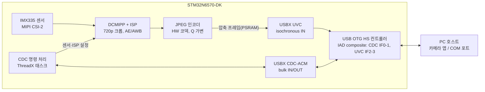

# PRD: STM32N6570-DK 기반 UVC 카메라 + USB CDC

작성일: 2026-11-13

## 1. 개요

STM32N6570-DK와 IMX335 카메라 모듈로 1280×720 30fps를 MJPEG로 압축해 보내는 USB UVC 카메라를 만든다. 같은 USB 케이블 하나에 CDC-ACM 가상 COM 포트를 함께 올려, 카메라 제어와 상태 조회를 할 수 있게 한다.

- **배경**: N6에는 MIPI CSI-2, DCMIPP와 ISP, 하드웨어 JPEG 코덱, H.264 인코더, USB 2.0 HS가 모두 들어 있다. 그래서 외부 브리지 칩 없이 단일 MCU로 UVC 카메라를 만들 수 있다.
- **문서 범위**: DK 보드에서 동작하는 펌웨어 프로토타입(PoC)까지 다룬다. 양산용 커스텀 보드, 기구, 인증은 범위 밖이다.
- **용어**: UVC = USB Video Class, CDC-ACM = USB 가상 시리얼 포트, VC/VS = VideoControl/VideoStreaming 인터페이스, IAD = Interface Association Descriptor.

## 2. 목표와 비목표

PC에 드라이버를 따로 설치하지 않고도 표준 카메라와 COM 포트로 동시에 인식되는 것이 핵심 목표다.

**목표**

1. 하나의 USB HS 포트에서 UVC와 CDC-ACM을 합친 composite 장치로 인식된다.
2. 1280×720 MJPEG 영상을 30fps로 끊김 없이 보낸다.
3. Windows 10/11과 Linux(UVC 드라이버)의 기본 드라이버만으로 영상과 COM 포트가 모두 동작한다.
4. CDC로 카메라 설정(노출, 화이트밸런스 등)과 상태(fps, 온도, 오류)를 주고받는다.
5. 영상 스트리밍 중에도 CDC 통신이 끊기거나 느려지지 않는다.

**비목표(이번 버전에서 하지 않음)**

- 무압축(YUY2/NV12) 720p30 전송: USB HS 대역폭을 넘어서 불가능하다(5장 참고).
- H.264 UVC 스트림: 후속 단계에서 검토한다.
- 1080p 이상 해상도, 오디오(UAC), AI 추론 기능.
- USB 외의 물리 UART 브리지(필요하면 10장 미결 사항에서 결정).

## 3. 사용 시나리오

주 사용자는 PC 호스트 애플리케이션을 만드는 개발자와, 장비를 점검하는 엔지니어다.

| # | 상황 | 사용자 행동 | 기대 결과 |
| --- | --- | --- | --- |
| S1 | 처음 연결 | USB-C 케이블로 PC에 꽂는다 | 5초 안에 카메라 1개와 COM 포트 1개가 장치 관리자에 나타난다 |
| S2 | 영상 확인 | Windows 카메라 앱, VLC, OBS, 또는 Linux의 guvcview를 연다 | 720p30 MJPEG가 선택 목록에 보이고 재생된다 |
| S3 | 설정 변경 | 터미널(Tera Term 등)이나 자체 앱에서 CDC로 명령을 보낸다 | 영상이 멈추지 않고 설정이 바로 반영되며 응답이 온다 |
| S4 | 상태 감시 | 호스트가 주기적으로 상태를 요청한다 | fps, 프레임 크기, 오류 카운터를 받는다 |
| S5 | 재연결 | 케이블을 뽑았다 다시 꽂거나 호스트가 절전 모드에서 깨어난다 | 보드 리셋 없이 다시 인식되고 스트리밍이 재개된다 |

## 4. 기능 요구사항

P0은 PoC에 반드시 들어가야 하는 기능이고, P1은 있으면 좋은 기능, P2는 후속 버전에서 할 기능이다.

| ID | 영역 | 요구사항 | 우선순위 |
| --- | --- | --- | --- |
| F-01 | USB | 하나의 USB OTG HS 포트에서 CDC-ACM(인터페이스 2개)과 UVC(VC/VS 인터페이스 2개)를 IAD로 묶은 composite 장치로 인식된다 | P0 |
| F-02 | UVC | UVC 1.1 이상의 MJPEG 포맷 디스크립터로 1280×720 30fps를 제공한다 | P0 |
| F-03 | UVC | 호스트의 Probe/Commit 요청에 응답하고, 호스트가 스트림을 열고 닫을 때 카메라 파이프라인을 시작/정지한다 | P0 |
| F-04 | UVC | 640×480 30fps MJPEG를 보조 해상도로 제공한다 | P1 |
| F-05 | UVC | 밝기, 대비, 화이트밸런스 등 UVC 표준 Processing Unit 컨트롤을 지원한다 | P2 |
| F-06 | 카메라 | IMX335를 MIPI CSI-2로 받아 DCMIPP와 ISP를 거쳐 1280×720 YUV를 만든다(센서 출력에서 크롭 또는 다운스케일) | P0 |
| F-07 | 카메라 | 자동 노출(AE)과 자동 화이트밸런스(AWB)가 동작한다 | P0 |
| F-08 | 인코딩 | 하드웨어 JPEG 코덱으로 프레임을 MJPEG로 압축하고, 품질(Q) 값을 바꿀 수 있다 | P0 |
| F-09 | CDC | PC에서 표준 COM 포트로 열리고, 기본 설정은 115200 8N1이다(USB에서는 설정값일 뿐 실제 속도를 제한하지 않는다) | P0 |
| F-10 | CDC | 7장의 명령 프로토콜로 설정 조회/변경과 상태 조회를 처리한다 | P0 |
| F-11 | CDC | 디버그 로그를 CDC로 출력한다(레벨 설정 가능) | P1 |
| F-12 | 시스템 | 케이블 분리/재연결, 호스트 suspend/resume 후 리셋 없이 복구한다 | P0 |
| F-13 | 시스템 | 펌웨어를 외부 플래시에 굽고 전원만 넣으면 부팅한다(FSBL + 앱) | P1 |
| F-14 | 시스템 | 보드 LED로 상태(대기/스트리밍/오류)를 표시한다 | P2 |

## 5. 비기능 요구사항

720p30은 MJPEG로 압축해야만 USB HS에 들어간다. 무압축은 대역폭이 2배 이상 모자라다.

**대역폭 계산**

| 포맷 | 프레임당 크기 | 30fps 대역폭 | USB HS isochronous 한계(24.6 MB/s) 대비 |
| --- | --- | --- | --- |
| YUY2 무압축 | 1,843,200 B | 55.3 MB/s | 225%, 불가 |
| NV12 무압축 | 1,382,400 B | 41.5 MB/s | 169%, 불가 |
| MJPEG (추정 Q 75~85) | 100~200 KB | 3~6 MB/s | 12~24%, 가능 |

USB HS isochronous 한계는 마이크로프레임(125 µs)마다 3 × 1024바이트를 보내는 high-bandwidth 설정 기준 이론값이다. MJPEG 프레임 크기는 장면에 따라 달라지므로 PoC에서 실측한다.

**품질 목표**

| 항목 | 목표치 | 측정 방법 |
| --- | --- | --- |
| 프레임레이트 | 30fps ± 0.5, 1시간 평균 | 호스트 타임스탬프 기록, CDC 상태 카운터 |
| 프레임 드롭 | 1시간에 0.1% 이하 | 호스트 측 수신 카운트 대비 장치 송신 카운트 |
| 지연(glass-to-glass) | 150 ms 이하(가정, 10장에서 확정) | 스톱워치 화면 촬영 비교 |
| 인식 시간 | 연결 후 5초 이내 | 수동 측정 10회 |
| CDC 응답 | 스트리밍 중 명령 응답 50 ms 이하 | 호스트 스크립트 1,000회 왕복 |
| 연속 동작 | 24시간 무중단 스트리밍 | soak 테스트 |
| 재연결 | 분리/연결 100회 중 100회 복구 | 자동 USB 스위치 또는 수동 |

**호환성**

- 호스트 OS: Windows 10/11, Ubuntu 22.04 이상(uvcvideo, cdc_acm 기본 드라이버).
- 확인할 앱: Windows 카메라, VLC, OBS Studio, OpenCV(VideoCapture), guvcview.
- 호스트 포트: USB 2.0 HS 이상. USB 3.x 포트와 허브에서도 동작해야 한다.

## 6. 시스템 아키텍처

카메라 영상과 CDC 명령은 각자 따로 처리되다가, 하나의 USB OTG HS 컨트롤러에서 composite 장치로 합쳐진다.

영상은 센서에서 ISP와 JPEG 인코더를 거쳐 UVC로 한 방향으로만 흐른다. CDC 명령은 양방향으로 오가고, 필요하면 센서와 ISP 설정을 바꾼다.

**버퍼 구성(안)**: ISP 출력 YUV 프레임(1280×720×2 = 약 1.8 MB) 2개와 MJPEG 출력 버퍼(각 256 KB) 2~3개를 외부 PSRAM에 둔다. 카메라 캡처, 인코딩, USB 전송이 서로 다른 버퍼를 쓰므로 서로 기다리지 않는다.

**USB 디스크립터 구성(안)**: 엔드포인트 번호는 제안값이며 예제 코드에 맞춰 조정한다.

| 인터페이스 | 클래스 | 엔드포인트 | 용도 |
| --- | --- | --- | --- |
| IAD 1 → IF0 | CDC Communication | 0x82 Interrupt IN | 시리얼 상태 알림 |
| IAD 1 → IF1 | CDC Data | 0x01 Bulk OUT, 0x81 Bulk IN (512 B) | 명령, 응답, 로그 |
| IAD 2 → IF2 | UVC VideoControl | EP0만 사용 | 카메라 제어 요청, VC header의 baInterfaceNr = 3 |
| IAD 2 → IF3 alt 0 | UVC VideoStreaming | 없음 | 스트림 대기(대역폭 0) |
| IAD 2 → IF3 alt 1~ | UVC VideoStreaming | 0x83 Isochronous IN (1024 B × 최대 3) | MJPEG 전송, alt별로 패킷 크기를 단계화 |

## 7. CDC 통신 프로토콜 초안

PoC에서는 터미널로 바로 입력할 수 있는 줄 단위 ASCII 명령을 쓴다. 나중에 호스트 앱이 생기면 바이너리 프레임을 더할 수 있게 명령 체계를 독립적으로 설계한다.

- **형식**: `명령 [인수...]\r\n` → 응답 `OK [값]\r\n` 또는 `ERR <코드> <설명>\r\n`
- **비동기 알림**: 장치가 먼저 보내는 메시지는 `EVT `로 시작한다(예: `EVT STREAM ON`).
- **line coding**: 호스트가 보낸 baud rate 값은 저장만 하고 동작에는 영향을 주지 않는다. 기본값은 115200 8N1로 보고한다.
- **DTR**: 호스트가 포트를 열었을 때(DTR=1)만 장치가 먼저 데이터를 보낸다.

| 명령 | 설명 | 응답 예 |
| --- | --- | --- |
| `VER?` | 펌웨어 버전, 빌드 날짜 | `OK 0.1.0 2026-11-13` |
| `STAT?` | 스트리밍 여부, 현재 fps, 평균 프레임 크기, 드롭 수 | `OK STREAM=1 FPS=30.0 AVG=152KB DROP=0` |
| `RES?` | 호스트가 선택한 해상도/fps | `OK 1280x720@30` |
| `JPEGQ <1-100>` | JPEG 품질 값 변경 | `OK` |
| `AE <0\|1>` | 자동 노출 끄기/켜기 | `OK` |
| `EXP <us>` | 수동 노출 시간 | `OK` |
| `GAIN <dB>` | 수동 게인 | `OK` |
| `AWB <0\|1>` | 자동 화이트밸런스 끄기/켜기 | `OK` |
| `LOG <0-3>` | 로그 레벨(0=끔, 3=상세) | `OK` |
| `RESET` | 소프트 리셋 | `OK` 후 재연결 |

## 8. 개발 환경과 참고 자료

ST가 공개한 예제 세 개를 합치는 방식으로 개발한다. 처음부터 새로 짤 부분은 composite 디스크립터와 CDC 명령 처리뿐이다.

| 항목 | 내용 |
| --- | --- |
| 보드 | STM32N6570-DK (리비전 확인 필요, 10장) |
| 카메라 | MB1854B IMX335 모듈(B-CAM-IMX) |
| 케이블 | USB-C 2개: ST-LINK(CN6) 전원·디버그용, USB OTG HS 데이터용 |
| IDE | STM32CubeIDE 또는 IAR EWARM, STM32CubeMX |
| 펌웨어 패키지 | STM32CubeN6 (최신 버전), ThreadX + USBX |
| 프로그래머 | STM32CubeProgrammer (외부 플래시용 External Loader 포함) |
| 디버깅 도구 | Wireshark + USBPcap(Windows), usbmon(Linux), USB Device Tree Viewer |

**참고할 예제**

- [x-cube-n6-camera-capture](https://github.com/STMicroelectronics/x-cube-n6-camera-capture): IMX335 → ISP → USB UVC 전체 흐름. 카메라·ISP 코드를 가져온다.
- [STM32CubeN6 Ux_Device_Video](https://github.com/STMicroelectronics/STM32CubeN6/tree/main/Projects/STM32N6570-DK/Applications/USBX/Ux_Device_Video): 카메라 없이 MJPEG 스트림을 보내는 USBX UVC 예제. UVC 클래스의 출발점.
- STM32CubeN6 Ux_Device_CDC_ACM: USBX CDC 예제.
- [How to implement the USB device composite class (ST 커뮤니티)](https://community.st.com/t5/stm32-mcus/how-to-implement-the-usb-device-composite-class-in-stm32-using/ta-p/645017): USBX composite 구성 방법.
- [CDC+UVC composite 인식 실패 사례 (ST 커뮤니티)](https://stcommunity.st.com/t5/stm32-mcus-embedded-software/stm32n6-usbd-composite-cdc-uvc-failed-to-enumerate-under-windows/td-p/887985): VC/VS 인터페이스 번호가 고정되어 생기는 문제와 해결책.

## 9. 마일스톤과 검증 기준

다섯 단계를 순서대로 진행하고, 각 단계의 완료 기준을 통과해야 다음 단계로 넘어간다. 일정은 아직 정하지 않았다(10장).

1. **M1 환경 구축과 예제 확인**
    - 작업: x-cube-n6-camera-capture, Ux_Device_Video, Ux_Device_CDC_ACM을 각각 빌드하고 굽는다.
    - 완료 기준: 세 예제가 모두 PC에서 정상 동작한다.
2. **M2 composite 인식(가짜 영상)**
    - 작업: CDC + UVC composite 디스크립터를 만들고, UVC는 고정 MJPEG 이미지를 보낸다.
    - 완료 기준: Windows와 Linux에서 카메라와 COM 포트가 동시에 동작하고, CDC 에코 테스트가 통과한다.
3. **M3 실제 카메라 연결**
    - 작업: IMX335 → DCMIPP/ISP → JPEG 인코더 → UVC 파이프라인을 연결한다.
    - 완료 기준: 720p30 실영상이 나오고, MJPEG 프레임 크기를 실측해 5장 대역폭 표를 갱신한다.
4. **M4 CDC 명령 구현**
    - 작업: 7장 명령을 구현하고 카메라 제어와 연결한다.
    - 완료 기준: 스트리밍 중 모든 명령이 50 ms 안에 응답하고 영상 끊김이 없다.
5. **M5 안정화와 검증**
    - 작업: 재연결·suspend 처리, 플래시 부팅, 5장 품질 목표 전체 측정.
    - 완료 기준: 24시간 soak 테스트와 재연결 100회를 통과한다.

## 10. 리스크와 미결 사항

가장 큰 리스크는 composite 디스크립터 오류로 UVC가 인식되지 않는 것이다. 그래서 M2에서 카메라 없이 먼저 확인한다.

**리스크**

| 리스크 | 영향 | 대응 |
| --- | --- | --- |
| 예제의 UVC 디스크립터에 VC/VS 인터페이스 번호(0/1)가 고정되어 있음 | CDC만 보이고 UVC는 인식되지 않음 | VC header의 baInterfaceNr, VS 모든 alternate setting의 번호를 동적으로 바꾼다. Wireshark로 디스크립터를 덤프해 확인한다 |
| ST의 UVC 라이브러리(uvcl)가 USB 스택 초기화를 직접 함 | composite 구성이 덮어써져 CDC가 동작하지 않음 | CubeMX가 만든 USBX composite 구조에 UVC 클래스를 직접 등록한다 |
| OTG HS TX FIFO 부족 | isochronous 패킷 누락, 프레임 깨짐 | FIFO를 UVC IN 엔드포인트에 우선 배정하고 CDC는 최소로 둔다 |
| ISP 파라미터가 720p 크롭과 맞지 않음 | 검은 화면이나 색 왜곡 | x-cube-n6-camera-capture의 ISP 설정을 그대로 쓰고, 필요하면 X-CUBE-ISP로 튜닝한다 |
| MJPEG 프레임이 예상보다 큼(복잡한 장면) | 대역폭 초과로 fps 하락 | JPEG Q를 동적으로 낮추고, dwMaxVideoFrameBufferSize를 여유 있게 잡는다 |
| N6에 내장 플래시가 없어 부팅 구조가 복잡함 | 개발 초기에 시간 소모 | 개발 모드로 시작하고, 플래시 부팅은 M5에서 예제 구조를 따른다 |

**미결 사항**

- [ ] CDC 용도 확정: PC와의 명령 통신만 할지, 보드의 물리 UART와 브리지해 115200으로 외부 장치와 연결할지
- [ ] 주 사용 호스트 OS와 사용할 앱(자체 앱 / OpenCV / 상용 앱)
- [ ] 지연 시간 목표치 확정(현재 150 ms 가정)
- [ ] 보조 해상도(640×480) 필요 여부
- [ ] H.264 지원을 후속 버전에 넣을지
- [ ] 보유한 DK 보드 리비전과 카메라 모듈 확인
- [ ] 마일스톤별 일정과 담당자
- [ ] USB VID/PID(개발 중에는 ST 기본값, 제품화 시 자체 발급)
